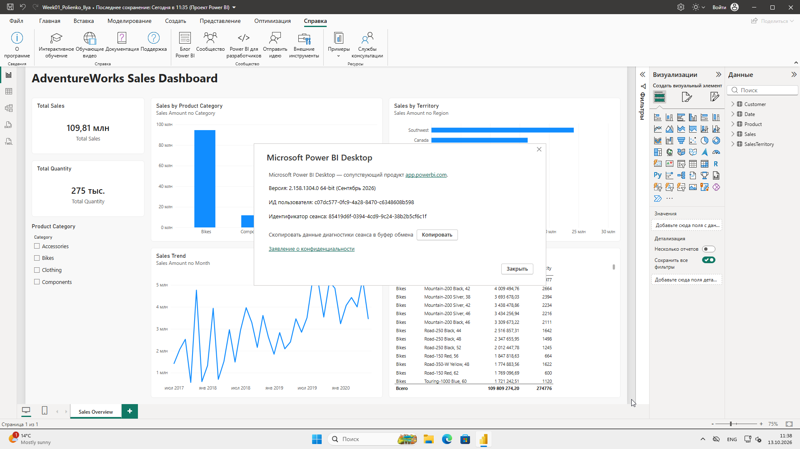
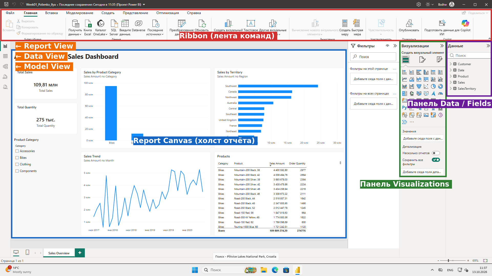
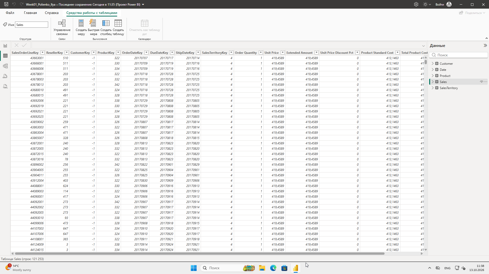
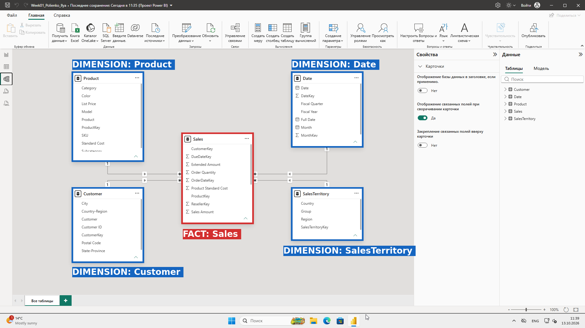
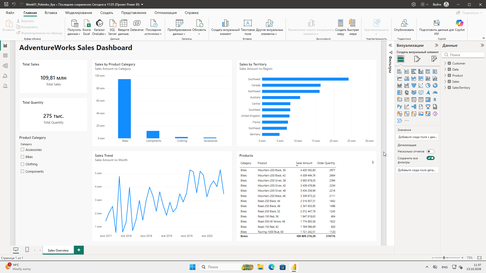
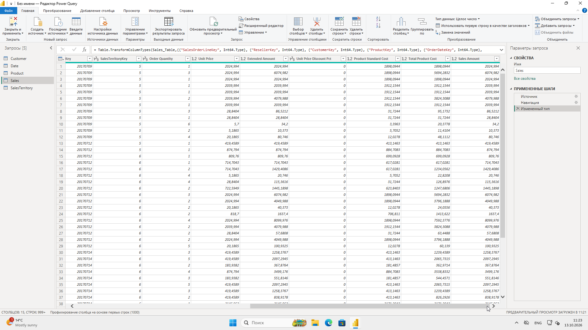
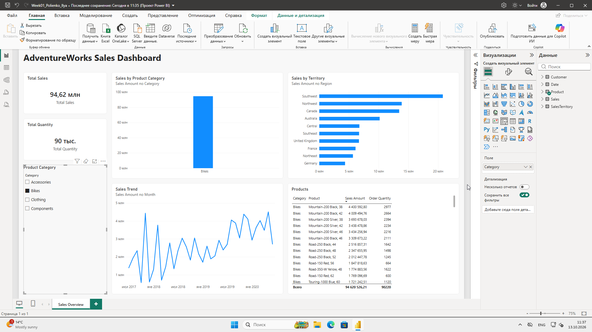

# Практическая работа №1. Установка Power BI Desktop и первый аналитический отчёт

**Студент:** Полиенко Илья, группа DS 24-Б
**Дисциплина:** Визуализация данных в Power BI
**Файл проекта:** `Week01_Polienko_Ilya.pbix`
**Данные:** `AdventureWorks Sales.xlsx` (учебный набор Microsoft)

## 1. Что сделано

| № | Шаг | Результат |
|---|-----|-----------|
| 1 | Установка Power BI Desktop | Версия 2.158.1304.0, 64-bit (сентябрь 2026) — скриншот 1 |
| 2 | Интерфейс | Ribbon, Report / Data / Model View, панели Data и Visualizations, Report Canvas — скриншот 2 |
| 3 | Подключение Excel | Получить данные → Книга Excel → Навигатор → выбраны таблицы Sales, Product, Customer, Date, SalesTerritory → Преобразовать данные |
| 4 | Проверка типов в Power Query | Order Quantity — целое число, Unit Price и Sales Amount — десятичное, Date[Date] — дата (доп. скриншот) |
| 5 | Close & Apply | В модель загружено 5 таблиц, Sales — 121 253 строки |
| 6 | Data View | Таблица Sales с данными — скриншот 3 |
| 7 | Model View | Звезда: Sales в центре, 4 измерения вокруг, связи 1:* — скриншот 4 |
| 8 | Страница «Sales Overview» | Заголовок, 2 карточки, срез, 3 диаграммы, таблица — скриншот 5 |
| 9 | Интерактивность | При выборе Bikes в срезе все визуалы пересчитываются: Total Sales 109,81 млн → 94,62 млн (доп. скриншот) |
| 10 | Сохранение | `Week01_Polienko_Ilya.pbix` |

### Связи в модели

Power BI сам нашёл три связи по одинаковым названиям ключей: ProductKey, CustomerKey, SalesTerritoryKey.
Связь с календарём пришлось создать вручную, потому что ключи называются по-разному: `Sales[OrderDateKey]` → `Date[DateKey]`.

| Из (многие, *) | В (один, 1) | Тип |
|---|---|---|
| Sales[ProductKey] | Product[ProductKey] | многие к одному, однонаправленный фильтр |
| Sales[CustomerKey] | Customer[CustomerKey] | многие к одному, однонаправленный фильтр |
| Sales[SalesTerritoryKey] | SalesTerritory[SalesTerritoryKey] | многие к одному, однонаправленный фильтр |
| Sales[OrderDateKey] | Date[DateKey] | многие к одному, однонаправленный фильтр |

### Визуализации на странице «Sales Overview»

| Визуал | Поля | Заголовок |
|---|---|---|
| Text Box | — | AdventureWorks Sales Dashboard |
| Card | Сумма Sales[Sales Amount] | Total Sales (109,81 млн) |
| Card | Сумма Sales[Order Quantity] | Total Quantity (275 тыс.) |
| Slicer | Product[Category] | Product Category |
| Clustered Column Chart | Product[Category], Сумма Sales Amount | Sales by Product Category |
| Line Chart | Date[Month], Сумма Sales Amount | Sales Trend |
| Table | Category, Product, Sales Amount, Order Quantity | Products |
| Clustered Bar Chart (самостоятельное задание, **вариант A**) | SalesTerritory[Region], Сумма Sales Amount | Sales by Territory |

На Line Chart по оси X взят столбец `Date[Month]` (первый день месяца). По дням 4 года данных дают слишком «шумный» график, а помесячно тренд читается лучше.

**Выводы по отчёту:**
- Bikes дают 94,62 млн из 109,81 млн, то есть ~86 % всей выручки.
- Лучший регион — Southwest.
- Продажи растут с середины 2017 года до 2020 года.

## 2. СРСП

### 2.1. Схема архитектуры Power BI-решения

```
 Source  ──►  Power Query  ──►  Model  ──►  DAX  ──►  Report
 (Excel)      (загрузка,        (таблицы,   (меры и     (страницы,
              очистка, типы)    связи)      расчёты)    визуалы, срезы)
```

| Компонент | Назначение (одним предложением) |
|---|---|
| **Source** | Источник исходных данных — здесь Excel-файл AdventureWorks Sales.xlsx (бывают также CSV, базы данных, веб-источники). |
| **Power Query** | Редактор, в котором данные подключаются, очищаются и преобразуются (типы, фильтры, переименования) до загрузки в модель. |
| **Model** | Модель данных: загруженные таблицы, связи между ними по ключам и структура «звезда» (факт + измерения). |
| **DAX** | Язык формул для мер и вычисляемых столбцов, например Total Sales = SUM(Sales[Sales Amount]). |
| **Report** | Отчёт: страницы с визуализациями, карточками, таблицами и срезами, с которыми пользователь работает интерактивно. |

### 2.2. Структура данных

| Роль | Таблица |
|---|---|
| Fact Table | **Sales** |
| Dimension 1 | **Product** (товары: название, категория, подкатегория, цвет, цена) |
| Dimension 2 | **Customer** (клиенты: имя, город, страна) |
| Dimension 3 | **Date** (календарь: дата, месяц, финансовый год и квартал) |
| Dimension 4 | **SalesTerritory** (территории: регион, страна, группа) |
| Grain Fact Table | **Одна строка Sales = одна строка заказа (один товар в одном заказе)**, ключ строки — SalesOrderLineKey |

### 2.3. Словарь данных

| № | Таблица | Поле | Тип | Назначение |
|---|---|---|---|---|
| 1 | Sales | Sales Amount | Decimal Number | Сумма продажи по строке заказа |
| 2 | Sales | Order Quantity | Whole Number | Количество проданного товара |
| 3 | Sales | ProductKey | Whole Number | Внешний ключ: какой товар продан (связь с Product) |
| 4 | Product | ProductKey | Whole Number | Первичный ключ: уникальный идентификатор товара |
| 5 | Product | Category | Text | Категория товара (Bikes, Components, Clothing, Accessories) |
| 6 | Customer | CustomerKey | Whole Number | Первичный ключ: уникальный идентификатор клиента |
| 7 | Date | Date | Date | Календарная дата |
| 8 | SalesTerritory | SalesTerritoryKey | Whole Number | Первичный ключ: код территории продаж |
| 9 | Sales | Unit Price | Decimal Number | Цена за единицу товара |
| 10 | Product | Product | Text | Название товара |
| 11 | Sales | OrderDateKey | Whole Number | Дата заказа в формате ГГГГММДД (связь с Date[DateKey]) |
| 12 | Sales | CustomerKey | Whole Number | Внешний ключ: клиент (связь с Customer) |
| 13 | Sales | SalesTerritoryKey | Whole Number | Внешний ключ: территория (связь с SalesTerritory) |
| 14 | Date | DateKey | Whole Number | Первичный ключ календаря (ГГГГММДД) |
| 15 | SalesTerritory | Region | Text | Регион продаж (Northwest, Canada, France, …) |
| 16 | Customer | Customer | Text | Имя клиента |

### 2.4. Определения

- **Fact (таблица фактов)** — таблица событий или операций с числовыми показателями: суммами и количествами. Она содержит внешние ключи на измерения и обычно состоит из большого числа строк. Здесь это Sales: 121 253 строки.
- **Dimension (таблица измерений)** — справочник с описательными атрибутами: названиями, категориями, датами, географией. По ним факты фильтруют и группируют. Строк в ней мало, каждый ключ уникален.
- **Grain (уровень детализации)** — что именно описывает одна строка таблицы фактов. Для Sales это одна строка заказа, то есть один товар в одном заказе.
- **Выбранные KPI:**
  - **Total Sales** — общая сумма продаж, Σ Sales[Sales Amount]. Это основной KPI, он равен 109,81 млн.
  - **Total Quantity** — общее количество проданных единиц, Σ Sales[Order Quantity]. Значение — 274 776.
  - **Продажи по категориям и по территориям** — показывают, откуда берётся выручка.

## 3. Ответы на вопросы для защиты

1. **Business Intelligence (BI)** — процессы и инструменты, которые превращают сырые данные в понятную информацию для принятия решений: отчёты, дашборды, KPI.
2. **Power BI** — платформа Microsoft для бизнес-аналитики. Она позволяет подключать данные, моделировать их, считать показатели и строить интерактивные отчёты.
3. **Power BI Desktop** — бесплатное приложение для Windows. В нём подключают источники, готовят данные в Power Query, строят модель, пишут DAX и создают отчёты.
4. **Desktop и Service.** Desktop — программа на компьютере, в ней отчёт создают. Service — облако в браузере, в нём отчёт публикуют, раздают доступ, настраивают автообновление и работают в рабочих областях.
5. **Report View** — представление, где на страницах отчёта строят визуализации: графики, карточки, таблицы и срезы.
6. **Data View** — просмотр загруженных в модель таблиц построчно: видны столбцы, значения и типы.
7. **Model View** — схема модели: таблицы в виде карточек и связи между ними, со стрелками и кардинальностью.
8. **Power Query** — встроенный ETL-редактор. В нём подключаются к источникам, очищают и преобразуют данные. Каждое действие записывается как шаг на языке M.
9. **Таблица фактов** хранит измеримые события (продажи, количества, суммы) и ключи на измерения. Строк в ней много.
10. **Таблица измерений** — справочник с описаниями (товар, клиент, дата, регион), по которому факты фильтруют и группируют.
11. **Fact Table в проекте** — Sales.
12. **Почему Sales — таблица фактов:** каждая её строка — это продажа с числовыми показателями (Order Quantity, Unit Price, Sales Amount). Ещё в ней есть внешние ключи ProductKey, CustomerKey, OrderDateKey и SalesTerritoryKey, которые ссылаются на измерения.
13. **Key (ключ)** — поле, которое однозначно определяет строку (первичный ключ в измерении) или ссылается на строку другой таблицы (внешний ключ в факте). По ключам строятся связи.
14. **ProductKey** — идентификатор товара. В Product он уникален, это первичный ключ. В Sales повторяется и показывает, какой товар продан, это внешний ключ.
15. **Связь 1:\*** (один-ко-многим): одной строке измерения соответствует много строк факта. Например, один товар встречается во многих продажах.
16. **Grain** — уровень детализации таблицы фактов, то есть ответ на вопрос «что представляет одна строка».
17. **Grain таблицы Sales** — одна строка заказа: один товар в одном заказе (SalesOrderLineKey).
18. **KPI** — ключевой показатель эффективности, число, по которому оценивают результат бизнеса. Например, Total Sales.
19. **Slicer (срез)** — визуальный фильтр на странице отчёта. Пользователь выбирает в нём значения, например категорию товара.
20. **Что происходит при выборе в Slicer:** все связанные визуалы на странице фильтруются по выбранному значению. При выборе Bikes карточка показывает 94,62 млн вместо 109,81 млн, и графики с таблицей тоже показывают только велосипеды.
21. **.pbix** — файл проекта Power BI Desktop. В нём хранятся запросы Power Query, модель с данными, меры DAX и страницы отчёта.
22. **Путь данных через Power BI:** Источник → Power Query (подготовка) → Модель (таблицы и связи) → DAX (расчёты) → Визуализации → Отчёт.

## 4. Скриншоты

**Скриншот 1 — версия Power BI Desktop**


**Скриншот 2 — интерфейс с подписями**


**Скриншот 3 — Data View, таблица Sales**


**Скриншот 4 — Model View: Fact и Dimension**


**Скриншот 5 — страница Sales Overview**


**Дополнительно: проверка типов в Power Query (таблица Sales)**


**Дополнительно: срез Category = Bikes фильтрует всю страницу**

