# Практическая работа №2 + СРСП №2. Продвинутый Power Query и ETL

**Студент:** Полиенко Илья, группа DS 24-Б
**Файл проекта:** `DS24-B_Polienko_Week2.pbix`
**Источник:** `Week2_Dirty_Sales_Student.xlsx` — исходный файл не изменялся, вся очистка сделана в Power Query.

Принцип работы: **PROFILING → DIAGNOSIS → TRANSFORMATION → VALIDATION → DOCUMENTATION**.

## 1. Data Profiling (задания 1–4)

- **Подключение.** «Получить данные → Excel» → листы Sales_Raw, Monthly_Sales, Regions, Products → «Преобразовать данные».
- **Параметр.** Путь к файлу вынесен в параметр `pSourceFile`. Все staging-запросы берут книгу из одного запроса-источника `src_Excel`.
- **Переименование.** Sales_Raw → `stg_Sales`, Monthly_Sales → `stg_MonthlySales`, Regions → `stg_Regions`, Products → `stg_Products`.
- **Профилирование.** Во вкладке «Просмотр» включены «Качество столбца», «Распределение столбцов» и «Профиль столбца». Режим переключён на «Профилирование столбца на основе всего набора данных» (скриншоты 01, 02).

### Задание 4. Первичный аудит stg_Sales (338 строк, 16 столбцов)

| № | Столбец | Проблема | Наблюдение / количество |
|---|---|---|---|
| 1 | OrderDate | Даты хранятся текстом в разных форматах | 26 дат в нестандартном формате (14 — `yyyy-mm-dd`, 12 — `dd/mm/yyyy`) |
| 2 | OrderDate | Невозможные даты и маркеры | 8 некорректных (`31/02/2026` ×2, `2026/99/12` ×2, `15-13-2026`, `wrong` ×3), 5 `N/A`, 6 пустых |
| 3 | City | Регистр и пробелы | 68 различных значений на 16 реальных городов (`  ALMATY  `, `almaty`, `Almaty `) |
| 4 | CustomerName | Пробелы по краям, двойные пробелы, ВЕРХНИЙ регистр | 219 различных значений, после нормализации 198 |
| 5 | Region | Пропуски и регистр | 11 пустых, 12 значений в ВЕРХНЕМ регистре (`NORTH`, `SOUTH-EAST`…) |
| 6 | Quantity | Пропуски и неположительные значения | 14 пустых, 17 значений ≤ 0 (от −3 до 0) |
| 7 | UnitPrice | Текст в числовом поле | 5 `-`, 4 `N/A`, 1 `one hundred`, 2 пустых |
| 8 | Discount | Текстовые проценты и маркеры | 3 `10%`, 3 `5 %`, 4 `-`, 3 `N/A`, 7 пустых |
| 9 | SalesAmount | Маркеры и числа-текст с пробелами | 3 `-`, 2 `error`, 2 `N/A`, 7 чисел вида `" 550000 "` |
| 10 | PaymentMethod | Один способ оплаты записан по-разному | 17 вариантов на 4 способа (`card`, `CARD`, ` Card`, `BANK CARD`, `kaspi qr`…) |
| 11 | Status | Регистр, пробелы, маркеры | 10 вариантов на 3 статуса, 4 `N/A`, 3 пустых |
| 12 | Manager | Пропуски | 12 пустых |
| 13 | Вся строка | Полные дубликаты | 18 строк полностью повторяют другие |
| 14 | OrderID | Не является уникальным номером заказа | У 157 из 160 OrderID разные клиенты и даты |
| 15 | CustomerID / CustomerName | Несогласованный справочник клиентов | У 96 из 112 CustomerID встречается несколько разных имён |

Проблемы других листов:
- **Regions:** у 9 из 16 городов пустые Region и RegionalManager, это иерархия для Fill Down.
- **Monthly_Sales:** 6 пропусков.
- **Все листы:** в конце диапазона есть пустые строки.

## 2. Cleaning (задания 5–10)

### Задание 5. Типы данных

| Поле | Тип | Комментарий |
|---|---|---|
| OrderID | Целое число | |
| OrderDate | Дата | Разбирается из трёх форматов (см. задание 8) |
| CustomerID, ProductCode | Текст | Идентификатор |
| CustomerName, City, Region, ProductName, Category, PaymentMethod, Manager, Status | Текст | |
| Quantity | Целое число | |
| UnitPrice, Discount, SalesAmount | Десятичное число | |

**Почему ID лучше хранить как Text.**
- Идентификатор — это метка, а не количество. Суммировать или усреднять его бессмысленно.
- В коде бывают буквы и ведущие нули (`C1016`, `ELEC-LAP-001`, `007`), а при числовом типе ведущие нули пропадают.
- Текстовый тип не даёт Power BI случайно агрегировать ключ («Сумма CustomerID») и гарантирует, что ключи совпадут при объединении таблиц.

### Задание 6. Очистка City и CustomerName

Шаги в stg_Sales:
- «Обрезанный текст» (Trim);
- «Очищенный текст» (Clean);
- «Двойные пробелы в CustomerName» (замена `"  "` на `" "`);
- «Каждое слово с прописной буквы» (Text.Proper).

| | До | После |
|---|---|---|
| Distinct City | **68** | **16** |
| Distinct CustomerName | 219 | 198 |

Различных значений City стало меньше, потому что `ALMATY`, `almaty`, ` Almaty` и `Almaty ` — это один город. Разница только в регистре и невидимых пробелах, а Power Query сравнивает строки посимвольно. После нормализации осталось 16 реальных городов, ровно столько же, сколько в справочнике Regions.

### Задание 7. Специальные маркеры

| Маркер | Где | Решение |
|---|---|---|
| `N/A` | OrderDate, UnitPrice, Discount, SalesAmount, Status | → null: значение неизвестно |
| `-` | UnitPrice, Discount, SalesAmount | → null |
| `error` | SalesAmount | → null, затем восстановление по формуле |
| `wrong` | OrderDate | → null |
| `10%`, `5 %` | Discount | **Не null:** это правильные значения в другом формате. Удаляются `%` и пробелы, результат делится на 100 → 0,10 и 0,05 |
| `BANK CARD` | PaymentMethod | → `Card`, это синоним |
| null в Manager | Manager | → `Не указан`: продажа реальная, удалять строку нельзя |
| null в Status | Status | → `Unknown` |

Маркера `Unknown` в исходных данных нет. Он вводится только для неизвестного статуса.

### Задание 8. Ошибки преобразования

Если сразу сменить тип на число или дату, появляются Error (скриншот 03).

| Поле | Причина ошибки | Как исправлено |
|---|---|---|
| UnitPrice | Текст `one hundred` | Ошибка заменена на null («Замененные ошибки»), затем цена берётся из прайса stg_Products |
| Discount | `10%`, `5 %` — текст с символом процента | Парсинг текста до смены типа (шаг «Discount из текста») |
| SalesAmount | `" 550000 "` — число с пробелами | Trim + Number.From (шаг «SalesAmount из текста») |
| OrderDate | Три формата и невозможные даты | Последовательно пробуются форматы `dd.MM.yyyy`, `yyyy-MM-dd`, `dd/MM/yyyy`, иначе null (шаг «OrderDate из разных форматов») |

Логику исправили до того, как что-либо удалять. Массово удалять строки с Error не понадобилось: после ETL ошибок нет ни одной.

### Задание 9. Анализ null

| Поле | Проблема | Решение | Обоснование |
|---|---|---|---|
| UnitPrice | 12 null (после маркеров и ошибки) | **Восстановить** из прайса stg_Products[StandardPrice] | Во всех заполненных строках UnitPrice = StandardPrice (0 расхождений), поэтому подстановка точная |
| SalesAmount | 7 null | **Восстановить**: Quantity × UnitPrice × (1 − Discount) | В 266 полных строках формула выполняется точно, расхождения только у строк с Quantity ≤ 0 |
| Quantity | 14 null | **Восстановить**: SalesAmount / (UnitPrice × (1 − Discount)) | Та же формула, решённая относительно количества |
| Discount | 14 null | **Восстановить** 13, **оставить** 1 null | Скидку можно вычислить, только если Quantity > 0. В строке с Quantity = 0 (Returned) скидка неизвестна, а 0 вместо null исказил бы среднюю скидку |
| Region | 10 null | **Восстановить** по City из stg_Regions | Связь City → Region в продажах на 100 % совпадает со справочником |
| Manager | 12 null | **Заменить** на `Не указан` | Восстановить нельзя: менеджер не зависит от региона. Удалять продажу тоже нельзя |
| OrderDate | 18 null | **Оставить** | Дату не из чего восстановить. Если удалить строки, выручка занизится на их суммы |

### Задание 10. Дубликаты и grain

**Grain Sales_Raw:** одна строка — одна товарная позиция в заказе.

Ключ строки — это не просто OrderID + ProductCode. OrderID в файле не уникален для заказа: под одним номером встречаются разные клиенты и даты (157 из 160 OrderID). Если удалять дубликаты по OrderID + ProductCode, удалилось бы 32 строки. Из них 14 — **разные продажи**: другая дата, другой клиент, другая сумма.

Поэтому подтверждённым дубликатом считается строка, у которой совпадают **все 16 полей после нормализации текста**. Таких строк 18.

| | Строк |
|---|---|
| До удаления дубликатов | 338 |
| После «Удаленные дубликаты» | **320** |
| Удалено | **18** |

## 3. Advanced Transformations (задания 11–20)

### Задание 11. Fill Down (stg_Regions)

«Преобразование → Заполнить → Вниз» по Region и RegionalManager (скриншот 06).

Лист устроен как иерархия: регион и менеджер записаны только в первой строке группы, ниже идут города этого региона. Fill Down копирует значение сверху, поэтому каждый город получает свой регион. Replace Values здесь не подходит: заменить null на одно фиксированное значение означало бы записать всем городам один регион.

### Задание 12. Fill Up (демонстрация)

Временно создан запрос **TEMP_FillUp** («Дублировать» stg_Regions), к которому применено «Заполнить → Вверх» (скриншот 07). Результат неверный: Kokshetau, Kostanay и Petropavl попали в South-East, а Taldykorgan — в South. Fill Up берёт значение из строки **ниже**, то есть из следующей группы.

Для данных, где заголовок группы стоит сверху, правильный выбор — Fill Down. Временный запрос после проверки удалён.

### Задания 13–14. Split и Merge (stg_Products, скриншот 08)

1. «Дублировать столбец» ProductCode, чтобы сохранить ключ для связей.
2. Копия разделена через «Разделить столбец → По разделителю `-`» на **DepartmentCode, ProductTypeCode, ProductNumber**: `ELEC-LAP-001` → `ELEC | LAP | 001`.
3. «Объединить столбцы» DepartmentCode и ProductTypeCode с разделителем `-` → **ProductGroupCode** = `ELEC-LAP`.

Split увеличивает число столбцов: одно поле превращается в три. Merge уменьшает: два поля становятся одним. Число строк в обоих случаях не меняется.

### Задание 15. Conditional Column SalesLevel

`SalesAmount >= 500000 → High; >= 100000 → Medium; иначе → Low`.

Итог: **Low 153, Medium 132, High 35**.

### Задание 16. Conditional Column OrderQuality

`Quantity <= 0 → Check; SalesAmount <= 0 → Check; иначе → OK`. Если поле пустое, тоже ставится Check.

Строк **Check: 16**. Они не удалены, потому что почти все — это Quantity = 0 или отрицательное при положительной SalesAmount и статусах Completed, Returned или Cancelled. Возможные причины:
- возврат или сторно, записанные минусом в количестве, тогда как сумма осталась положительной;
- корректировка остатков;
- ошибка ввода знака.

Решение должен принять бизнес, поэтому строки помечены, а не удалены.

### Задание 17. Column From Examples

- В stg_Products: «Добавление столбца → Столбец из примеров», пример `LAP` для `ELEC-LAP-001`. Power Query сам сгенерировал формулу `Text.BetweenDelimiters([ProductCode], "-", "-")`, получился столбец **ProductTypeFromExample**.
- В FactSales: по примеру фамилии получен столбец **CustomerLastName** с формулой `Text.AfterDelimiter([CustomerName], " ")`.

**Сравнение со Split.** Split делит исходный столбец на несколько новых, и исходный пропадает. Column From Examples добавляет **один** новый столбец и оставляет исходный. Формулу при этом не пишут вручную, Power Query подбирает её по введённым примерам.

### Задание 18. Group By

Запрос **Sales_By_City** — Reference («Ссылка») от очищенного запроса продаж. «Группировать по» City (скриншот 09):
- TotalSales = Сумма SalesAmount;
- AvgSales = Среднее;
- RowsCount = Количество строк;
- MaxSales = Максимум.

Первое место — Kostanay (5,65 млн).

- **Grain BEFORE** = одна строка — одна товарная позиция в заказе (320 строк).
- **Grain AFTER** = одна строка — один город (16 строк).

Reference взят от FactSales, а не от stg_Sales. В FactSales уже восстановлены SalesAmount, Quantity и UnitPrice, поэтому итоги по городам совпадают с моделью. Иначе в сумме не хватало бы 7 восстановленных продаж.

### Задание 19. Unpivot (SalesMonthly)

В запросе SalesMonthly (Reference от stg_MonthlySales) Product оставлен идентификатором, затем «Отменить свертывание других столбцов», после чего Attribute → **Month**, Value → **Sales** (скриншот 11). Добавлен MonthNumber, чтобы месяцы сортировались по порядку.

Было 10 строк × 8 месяцев, стало **74 строки**. Получилось 80 − 6, потому что Unpivot пропускает пустые ячейки.

Почему длинный формат Product | Month | Sales удобнее:
1. Одна мера `SUM(Sales)` работает для любого месяца. Не нужно 8 отдельных столбцов и 8 мер.
2. Месяц становится измерением: его можно положить на ось, в срез или фильтр и связать с календарём.
3. Новый месяц добавляется новыми строками без изменения структуры, запросов и визуалов.
4. С длинным форматом работают Group By, связи и временной анализ (тренды, MoM).

### Задание 20. Pivot

Запрос **Sales_City_Payment**: Reference → оставлены City, PaymentMethod и SalesAmount → «Сводный столбец» по PaymentMethod со значением Sum SalesAmount (скриншот 10). Получилась таблица 16 городов × 4 способа оплаты: Card, Cash, Kaspi QR, QR.

| Операция | Что делает | Когда применять |
|---|---|---|
| Pivot | Значения одного столбца становятся заголовками новых столбцов, строки агрегируются. Таблица из длинной становится широкой | Для итоговой кросс-таблицы или отчёта: сравнить категории рядом, выгрузить матрицу |
| Unpivot | Заголовки столбцов становятся значениями в строках (Attribute/Value). Таблица из широкой становится длинной | Когда данные пришли «как в Excel» (месяцы или годы в столбцах). Это подготовка к модели и анализу |

## 4. Architecture (задания 21–25)

### Задание 21. Staging-архитектура

Группы запросов (скриншот 15):

```
Параметры     pSourceFile
00_STAGING    src_Excel, stg_Sales, stg_Products, stg_Regions, stg_MonthlySales
10_MODEL      FactSales, DimProduct, DimRegion, SalesMonthly
20_ANALYSIS   Sales_By_City, Sales_City_Payment
```

### Задание 22. Reference

`FactSales` = «Ссылка» на stg_Sales. В нём выполняются бизнес-правила:
- восстановление цены, скидки, количества и суммы;
- восстановление Region;
- SalesLevel и OrderQuality.

Источник при этом второй раз не читается.

Тем же способом сделаны ссылки DimProduct → stg_Products, DimRegion → stg_Regions, SalesMonthly → stg_MonthlySales, а также Sales_By_City и Sales_City_Payment → FactSales.

### Задание 23. Duplicate

Создан **TEST_Sales_Duplicate** («Дублировать» stg_Sales), в нём удалён столбец Manager (скриншот 12). В stg_Sales Manager остался. После проверки тестовый запрос удалён.

| Объект | Изменение stg_Sales повлияло? | Почему |
|---|---|---|
| Reference / FactSales | **Да** | Ссылка начинается шагом `Источник = stg_Sales` и каждый раз вычисляет результат stg_Sales. Любая правка раннего шага stg_Sales переходит во FactSales и во все запросы ниже |
| Duplicate / TEST_Sales_Duplicate | **Нет** | Дубликат — независимая копия M-кода на момент копирования. Изменения в stg_Sales в него не попадают, его нужно править отдельно |

### Задание 24. Отключение загрузки

Для pSourceFile, src_Excel и четырёх stg-запросов снят флажок «Включить загрузку». На скриншоте 15 у них подпись «Загрузка отключена», в списке запросов они курсивом.

В модель загружаются только FactSales, DimProduct, DimRegion, SalesMonthly, Sales_By_City и Sales_City_Payment. Только они нужны отчёту. Если загружать staging, модель удваивается, а в полях появляются лишние таблицы с «сырыми» данными.

### Задание 25. Зависимости запросов

Скриншот 15 показывает цепочку **Source → Staging → Final**:

```
файл .xlsx + pSourceFile → src_Excel → stg_* → FactSales/Dim*/SalesMonthly → Sales_By_City, Sales_City_Payment
```

## 5. Before / After и аудит качества (задания 26–30)

### Задание 26. Data Quality Report

| № | Столбец | Проблема | До | Действие Power Query | После |
|---|---|---|---|---|---|
| 1 | City | Регистр, пробелы | 68 distinct | Обрезать → Очистить → Каждое слово с прописной | 16 distinct |
| 2 | CustomerName | Пробелы, двойные пробелы, регистр | 219 distinct | Обрезать, Очистить, Замена `"  "`, Proper | 198 distinct |
| 3 | Region | Регистр + 11 null | 14 вариантов | Proper + Merge со stg_Regions по City | 7 регионов, 0 null |
| 4 | PaymentMethod | 17 написаний | 17 | Нормализация (Upper + сопоставление, BANK CARD → Card) | 4: Card 86, Cash 79, QR 78, Kaspi QR 77 |
| 5 | Status | Регистр, пробелы, N/A, null | 10 вариантов | Trim, N/A → null, Proper, null → Unknown | 4: Completed 217, Cancelled 51, Returned 46, Unknown 6 |
| 6 | OrderDate | 3 формата, невозможные даты, маркеры | Текст, 19 непригодных | Разбор по 3 форматам, иначе null | Тип Date, 18 null (после удаления дубликатов) |
| 7 | UnitPrice | `-`, `N/A`, `one hundred`, null | 12 непригодных | Маркеры → null, Error → null, цена из прайса | 0 null |
| 8 | Discount | `10%`, `5 %`, `-`, `N/A`, null | 20 непригодных | Парсинг процентов, восстановление по формуле | 1 null |
| 9 | SalesAmount | `-`, `error`, `N/A`, числа-текст | 14 непригодных | Trim + Number.From, восстановление Q × P × (1 − D) | 0 null |
| 10 | Quantity | 14 null, 17 значений ≤ 0 | 14 null | Восстановление по формуле, флаг OrderQuality | 0 null, 16 строк Check |
| 11 | Manager | 12 null | 12 | null → `Не указан` | 0 null |
| 12 | Строки | Полные дубликаты | 18 | Удалить дубликаты по всем столбцам | 0 |

### Задание 27. Applied Steps запроса FactSales

| № | Applied Step | Что делает | Почему нужен |
|---|---|---|---|
| 1 | Источник | Берёт результат stg_Sales (Reference) | Бизнес-логика отделена от технической очистки, источник не читается повторно |
| 2 | Объединенные запросы | Left Outer Merge со stg_Products по ProductCode | Подтягивает прайс |
| 3 | Развернутый элемент stg_Products | Разворачивает только StandardPrice | Остальные поля справочника в факте не нужны |
| 4 | UnitPrice из прайса | Если UnitPrice = null, берёт StandardPrice | 12 цен восстановлены точно |
| 5 | Восстановлен Discount | 1 − SalesAmount / (Quantity × UnitPrice), если Quantity > 0 | 13 скидок восстановлены |
| 6 | Восстановлено Quantity | SalesAmount / (UnitPrice × (1 − Discount)) | 14 количеств восстановлены |
| 7 | Восстановлена SalesAmount | Quantity × UnitPrice × (1 − Discount) | 7 сумм вместо `error`, `-`, `N/A` |
| 8 | Объединенные запросы1 | Merge со stg_Regions по City | Справочник регионов |
| 9 | Развернутый элемент stg_Regions | Разворачивает Region как RegionFromDirectory | Временный столбец для подстановки |
| 10 | Region из справочника | Если Region = null, берёт регион города | 10 пустых регионов заполнены |
| 11 | Замененное значение null в Manager | null → «Не указан» | Без пустых в срезах, строка сохраняется |
| 12 | Замененное значение null в Status | null → «Unknown» | То же |
| 13 | Добавлен SalesLevel | Условный столбец High / Medium / Low | Сегментация продаж (задание 15) |
| 14 | Добавлен OrderQuality | Условный столбец Check / OK | Пометка подозрительных строк (задание 16) |
| 15 | Фамилия клиента (столбец из примеров) | CustomerLastName | Задание 17 |
| 16 | Удаленные столбцы | Удаляет StandardPrice и RegionFromDirectory | Технические столбцы не нужны в модели |
| 17 | Измененный тип | Явно задаёт типы Quantity, UnitPrice, Discount, SalesAmount и текстов | После замен через формулы тип столбца становится «Любой», поэтому типы фиксируются заново |

### Задание 28. Лишний шаг

При подключении к листу Power Query сам добавляет шаг **«Измененный тип»** сразу после «Повышенные заголовки». Он определяет типы по первым строкам. Для Sales_Raw этот шаг избыточен и даже вреден:
- он превращал OrderDate, UnitPrice, Discount и SalesAmount в Error раньше, чем их можно разобрать;
- типы всё равно задаются ещё раз позже, явными шагами «Тип текстовых полей» (после загрузки) и «Измененный тип» (после парсинга).

Поэтому в итоговом запросе этого шага нет. Результат без него тот же (320 строк, 0 ошибок), а типы задаются один раз и в правильном месте.

### Задание 29. Before / After

| Показатель | До ETL | После ETL |
|---|---|---|
| Количество строк | 338 | **320** |
| Количество столбцов | 16 | **19** (+SalesLevel, OrderQuality, CustomerLastName) |
| Значения, не подходящие под тип (текст в числах, невалидные даты) | 50 (UnitPrice 10, Discount 13, SalesAmount 14, OrderDate 13) | **0** Error |
| Null (вместе со скрытыми: `N/A`, `-`, `error`, `wrong`) | 90 (55 пустых + 35 маркеров) | **19** (OrderDate 18, Discount 1) |
| Подтверждённые дубликаты | 18 | **0** |
| Distinct City | 68 | **16** |
| Некорректные типы | 4 смешанных столбца (OrderDate, UnitPrice, Discount, SalesAmount) | **0**, все 19 столбцов типизированы |

### Задание 30. Воспроизводимость

Сделана копия файла `Week2_Dirty_Sales_Student_plus5_TEST.xlsx` с 5 новыми «грязными» строками:
- `  ruslan abilov `, `ASTANA `, `north`;
- UnitPrice = `N/A`;
- Discount = `10%` и SalesAmount = `error`;
- пустой Quantity и пустой Manager;
- `BANK CARD`.

В параметре pSourceFile указан путь к копии через «Изменить параметры», затем «Применить изменения» (скриншоты 13, 14).

**Вывод.** После Refresh во FactSales стало **325** строк (343 сырых − 18 дубликатов), Total Sales вырос с 65,06 до 65,73 млн. Число строк Check осталось 16, City по-прежнему 16. Значит, новые строки прошли все шаги автоматически: город нормализован, цена взята из прайса, процент разобран, сумма и количество восстановлены, способ оплаты приведён к Card. Ни одного ручного действия не понадобилось, потому что ETL описан шагами M, а не правками в ячейках. После проверки параметр возвращён на исходный файл.

## 6. Аналитическое объяснение (задания 31–33)

### Задание 31. Критические ситуации

| Ситуация | Объяснение |
|---|---|
| Quantity = −2, строку удалили | Отрицательное количество может быть бизнес-событием. Во-первых, это **возврат или сторно**: товар вернули, и учётная система пишет движение со знаком минус. Во-вторых, это **корректировка**: пересорт, исправление ошибочной продажи, списание. Если удалить такую строку, продажи завысятся, а возвраты потеряются. Строку нужно пометить (OrderQuality = Check) и выяснить её смысл |
| Discount = null заменили на 0 | Это допустимо, только если по бизнес-правилу пусто означает «скидки не было» и это подтверждено источником. В остальных случаях данные искажаются: средняя скидка занижается, а SalesAmount, пересчитанная по формуле, завышается. Правильнее восстановить скидку по формуле, если хватает данных, или оставить null |
| Дубликаты удалили только по ProductName | Это критическая ошибка: ProductName — атрибут товара, а не ключ строки. Grain — одна позиция в заказе, поэтому один товар законно встречается в сотнях разных продаж. Удаление по ProductName оставило бы по одной строке на товар (15 строк из 320) и уничтожило бы почти всю выручку |
| Group By в самом начале | Пропадает детализация. Невозможно анализировать: 1) динамику по датам (тренд, MoM), 2) продажи по клиентам и товарам внутри города, 3) способы оплаты, статусы и возвраты, 4) скидки и средний чек на уровне строки. Восстановить эти данные после агрегации нельзя, поэтому Group By делают в отдельном Reference в конце ETL |

### Задание 32. Схема ETL

```
ИСТОЧНИКИ (листы Excel, путь = pSourceFile)
  Sales_Raw        Products         Regions          Monthly_Sales
      │                │                │                  │
      └──────────── src_Excel (Excel.Workbook) ────────────┘
      │                │                │                  │
STAGING [Data Profiling: качество / распределение / профиль]
  stg_Sales        stg_Products     stg_Regions      stg_MonthlySales
  (trim, clean,    (split/merge,    (fill down)      (типы)
   маркеры, типы,   из примеров)
   дубликаты)
      │                │                │                  │
      │ Reference      │ Reference      │ Reference        │ Reference
      ▼                ▼                ▼                  ▼
FINAL (модель)
  FactSales ◄──merge── DimProduct      DimRegion        SalesMonthly [UNPIVOT]
      │ ◄──merge────────────────────────┘
      ├── Reference → Sales_By_City       [GROUP BY]
      └── Reference → Sales_City_Payment  [PIVOT]
```

### Задание 33. Power Query как ETL-слой (172 слова)

Power Query — это не инструмент для удаления лишних строк, а полноценный ETL-слой аналитической системы. Extract: он подключается к источникам через параметры, поэтому путь к данным меняется без правки логики. Transform: каждая операция записывается как Applied Steps на языке M. Получается не разовая ручная правка, а документированная и проверяемая последовательность трансформаций. Load: в модель попадают только финальные таблицы, а промежуточные staging-запросы остаются внутри слоя подготовки.

Такой подход обеспечивает reproducibility. При Refresh те же шаги автоматически применяются к новым данным, что подтвердил тест с пятью добавленными строками. Data Quality становится измеримой: профилирование показывает ошибки, пропуски и различные значения до и после, а решения по null, Error и дубликатам обосновываются grain-ом таблицы, а не интуицией. Разделение на staging и final queries через Reference делает зависимости прозрачными и позволяет менять одну стадию, не ломая другие. В итоге model получает чистые, типизированные и согласованные данные, а отчёт — достоверные показатели.

## 7. Ответы на контрольные вопросы

1. **ETL** (Extract, Transform, Load) — извлечение данных из источников, их очистка и преобразование, затем загрузка в хранилище или модель. Power Query в Power BI выполняет все три этапа: подключение, шаги M и загрузку в модель.
2. **Профилирование.** «Качество столбца» показывает доли допустимых значений, ошибок и пустых. «Распределение столбцов» — число различных и уникальных значений и гистограмму. «Профиль столбца» — статистику (min, max, среднее, пустые строки) и распределение значений выбранного столбца.
3. **Почему нельзя удалять все null и Error.** Строка с одним пустым полем обычно содержит ценные данные: сумму, клиента, товар. Ошибка часто означает другой формат, а не мусор. Сначала выясняют причину, восстанавливают то, что можно, и только потом решают, что делать с остальным.
4. **Trim и Clean.** Trim удаляет пробелы в начале и конце строки. Clean удаляет непечатаемые управляющие символы (переводы строк, табуляцию и подобное).
5. **Fill Down** нужен, когда значение указано только в первой строке группы, а ниже подразумевается то же самое: иерархии, объединённые ячейки, отчёты «лесенкой».
6. **Split и Merge.** Split делит один столбец на несколько, столбцов становится больше. Merge склеивает несколько столбцов в один. Число строк не меняется в обоих случаях.
7. **Conditional Column** добавляет столбец, значение которого вычисляется по правилам «если — то — иначе» на основе других столбцов.
8. **Column From Examples** — новый столбец, который строится по нескольким введённым примерам. Power Query сам подбирает формулу. В отличие от Split, он добавляет один столбец и сохраняет исходный.
9. **Group By** агрегирует строки по ключу (сумма, среднее, количество, максимум) и делает grain крупнее. Было «позиция заказа», стало «город».
10. **Pivot и Unpivot.** Pivot превращает значения в столбцы, таблица становится шире. Unpivot превращает столбцы в строки, таблица становится длиннее.
11. **Unpivot для месяцев** превращает «месяцы в столбцах» в измерение Month. Тогда работают одна мера, срезы, связь с календарём и автоматический учёт новых месяцев.
12. **Staging query** — промежуточный запрос, который подключается к источнику и выполняет техническую очистку. Он служит основой для финальных запросов и обычно не загружается в модель.
13. **Reference и Duplicate.** Reference ссылается на результат исходного запроса, поэтому изменения исходника передаются дальше. Duplicate — независимая копия всех шагов, изменения исходника на неё не влияют.
14. **«Зависимости запросов»** — граф: какие запросы от каких зависят, где источник данных и какие запросы загружаются в модель.
15. **Отключение загрузки** нужно, чтобы промежуточные таблицы не дублировали данные в модели, не увеличивали размер файла и не путали пользователя лишними полями.
16. **Воспроизводимый ETL** даёт тот же результат при повторном запуске и автоматически обрабатывает новые данные, без ручных правок.
17. **Порядок шагов.** Каждый шаг работает с результатом предыдущего. Например, если сменить тип до очистки маркеров, появятся Error. Если удалить дубликаты до нормализации текста, часть дублей не найдётся.
18. **Дубликаты и grain.** Только grain определяет, какие строки — одно и то же событие. Если удалять по неполному ключу, исчезнут разные, но похожие продажи.
19. **Как доказать улучшение качества.** Нужна таблица Before/After по метрикам: строки, ошибки, null, дубликаты, distinct, типы. Плюс профилирование до и после и сверка итогов, например формула Q × P × (1 − D).
20. **Правильный ETL при Refresh** перечитывает источник и повторяет все шаги. Новые данные очищаются автоматически, отчёт обновляется без ошибок и ручных действий.

## 8. Скриншоты

| № | Файл | Что показано |
|---|---|---|
| 01 | Скриншоты/01_Профилирование_ДО_City_68.png | Профилирование до очистки: City — 68 различных значений, 338 строк |
| 02 | Скриншоты/02_Профилирование_ПОСЛЕ_City_16.png | После очистки: 16 различных, 320 строк, полный список Applied Steps stg_Sales |
| 03 | Скриншоты/03_Ошибки_после_смены_типа.png | Ошибка в UnitPrice (`one hundred`) на шаге «Измененный тип» |
| 04 | Скриншоты/04_FactSales_Applied_Steps.png | 17 шагов FactSales |
| 05 | Скриншоты/05_Conditional_и_ColumnFromExamples.png | SalesLevel, OrderQuality, CustomerLastName |
| 06 | Скриншоты/06_FillDown_stg_Regions.png | Fill Down |
| 07 | Скриншоты/07_FillUp_TEMP_дубликат.png | Fill Up на временной копии (неверный результат) |
| 08 | Скриншоты/08_Split_Merge_ColumnFromExamples_stg_Products.png | Split / Merge / Column From Examples |
| 09 | Скриншоты/09_GroupBy_Sales_By_City.png | Group By |
| 10 | Скриншоты/10_Pivot_City_x_PaymentMethod.png | Pivot |
| 11 | Скриншоты/11_Unpivot_SalesMonthly.png | Unpivot |
| 12 | Скриншоты/12_TEST_Sales_Duplicate.png | Duplicate без Manager |
| 13 | Скриншоты/13_Параметр_pSourceFile_копия_+5.png | Смена источника для теста воспроизводимости |
| 14 | Скриншоты/14_Refresh_325_строк_шаги_применились.png | После Refresh — 325 строк |
| 15 | Скриншоты/15_Зависимости_запросов.png | Зависимости запросов |
| 16 | Скриншоты/16_Отчёт_ETL_Results.png | Страница отчёта ETL Results |
| 17 | Скриншоты/17_Модель.png | Модель: FactSales ↔ DimProduct, DimRegion |

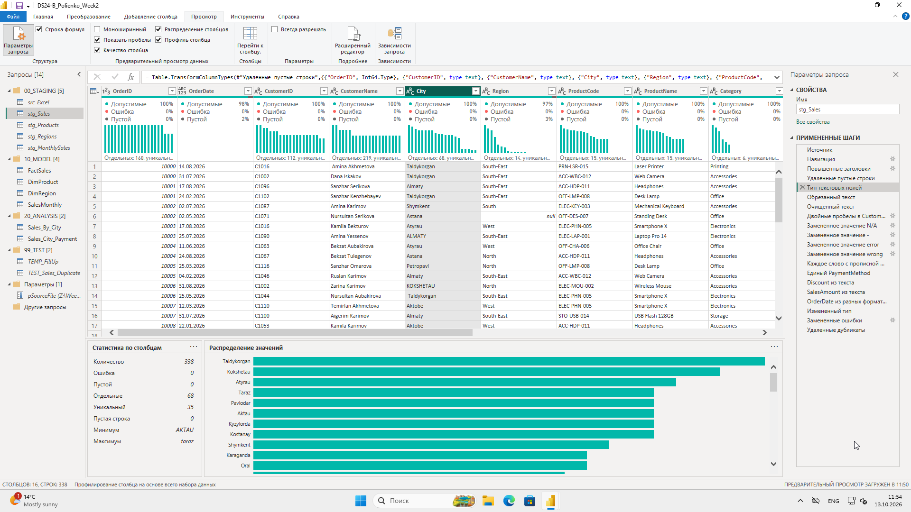
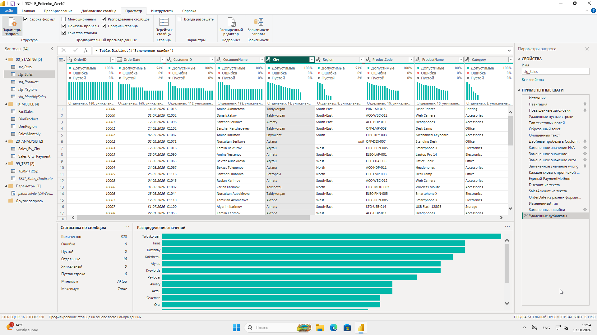
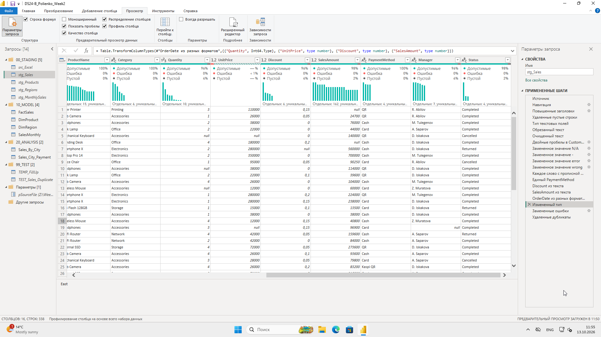
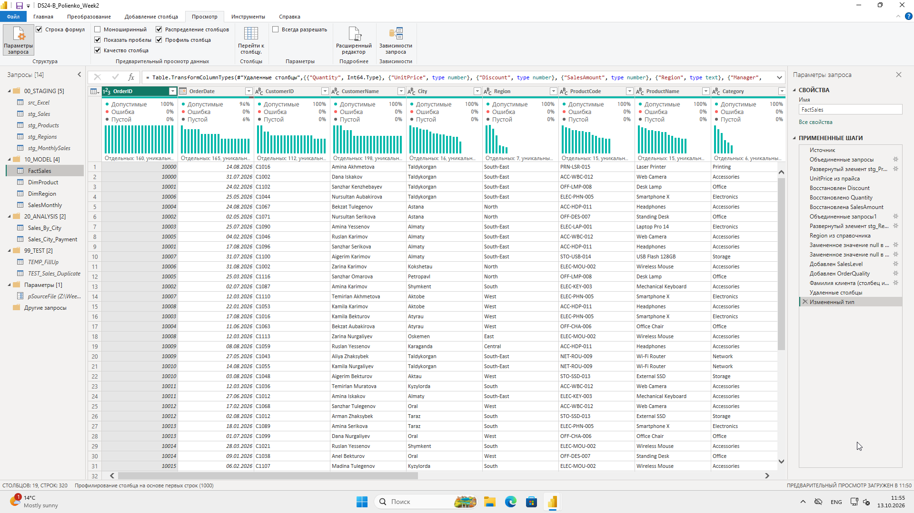
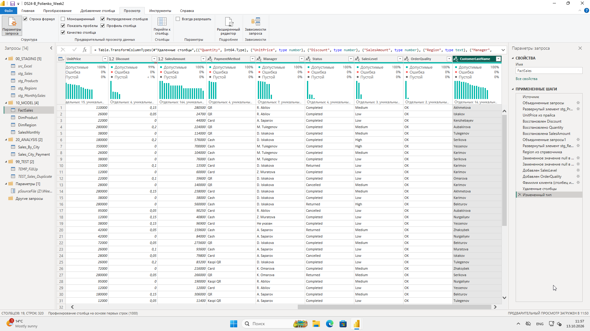
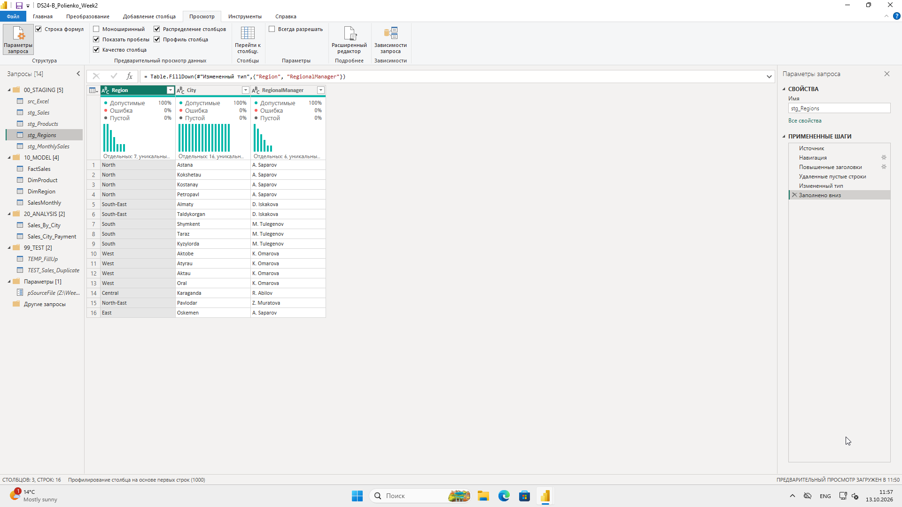
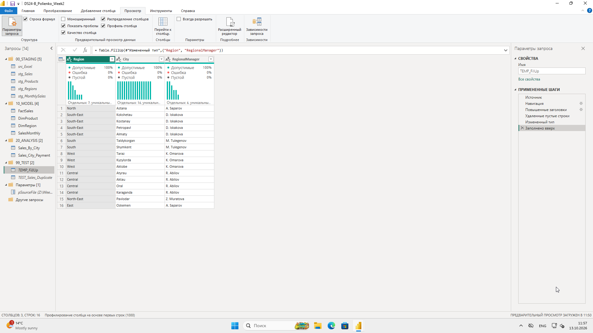
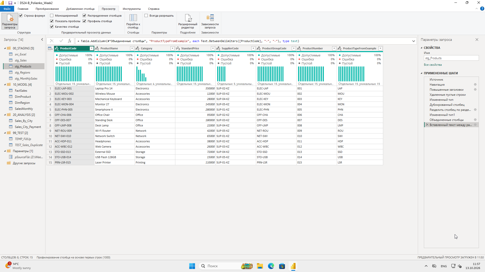
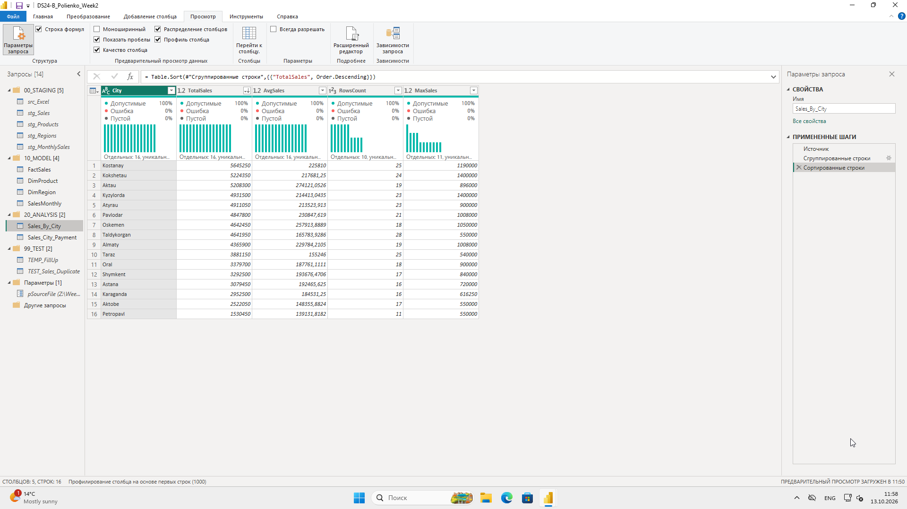
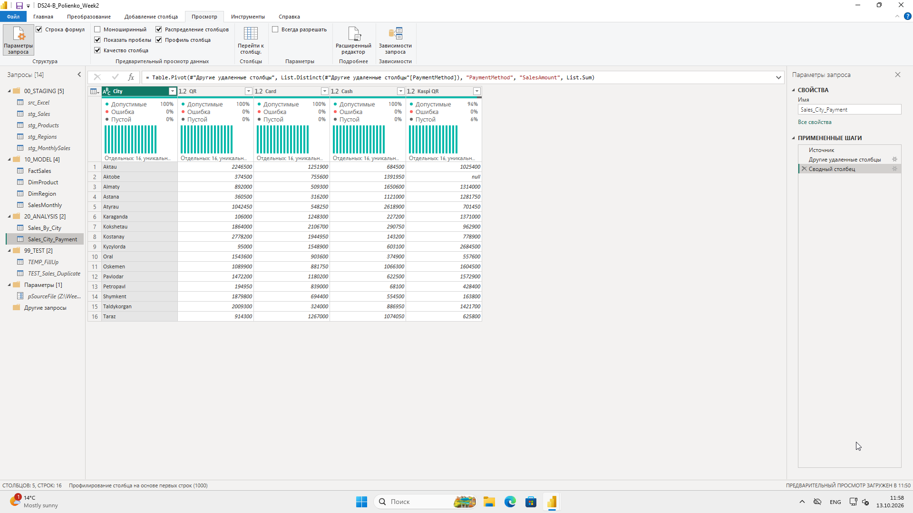
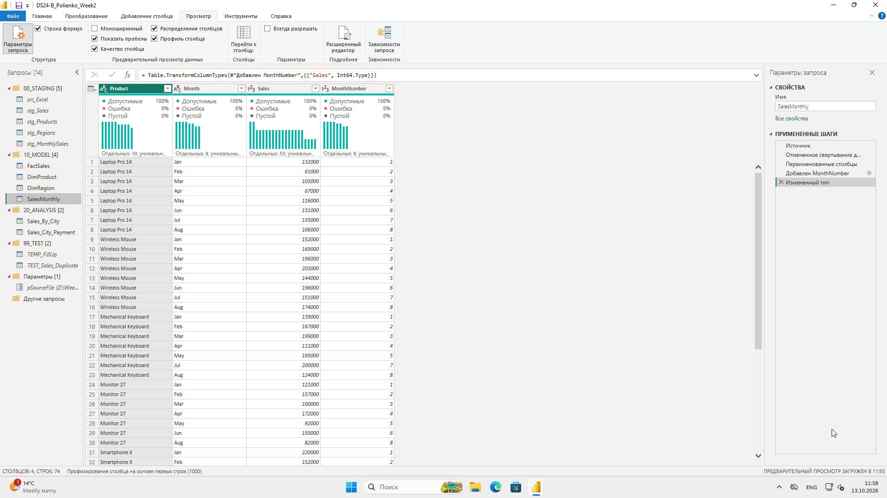
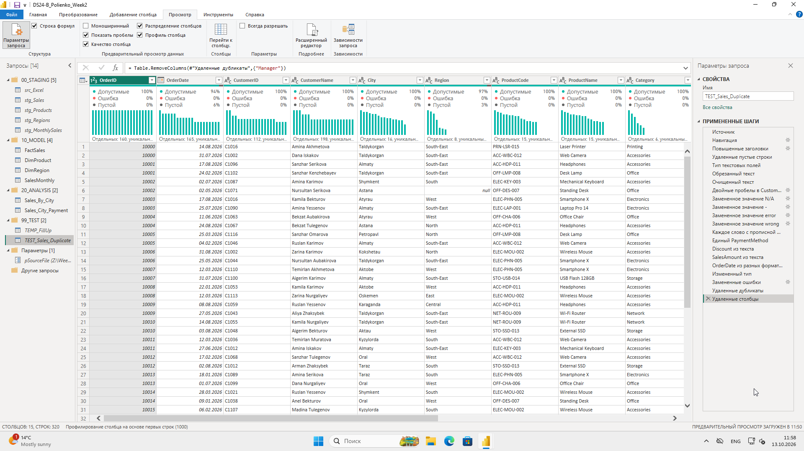
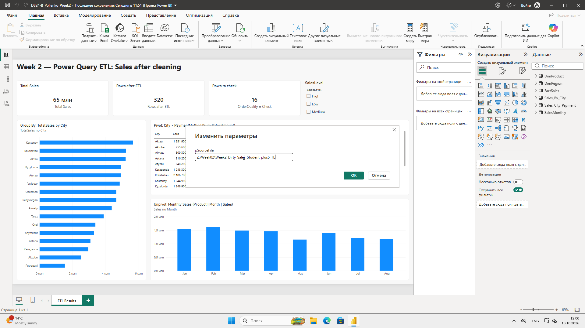
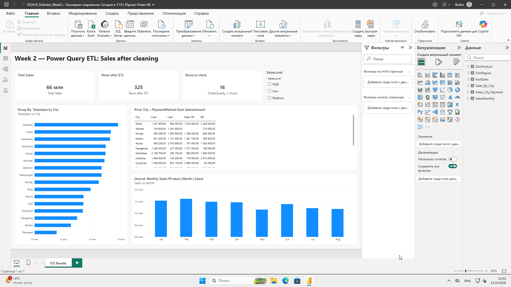
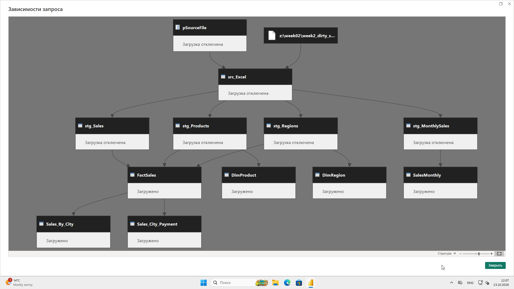
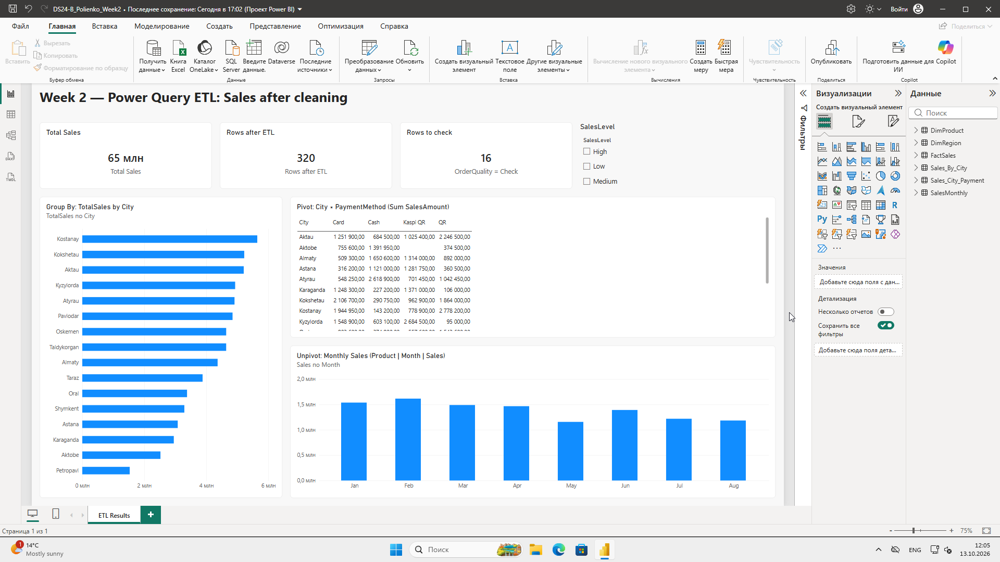
