# Практическая работа №3 + СРСП №3. Объединение и автоматизация данных в Power Query

**Студент:** Полиенко Илья, группа DS 24-Б
**Файл проекта:** `Week3_Polienko.pbix`
**Данные:** `01_Продажи_по_месяцам` (январь–апрель 2026, таблица SalesTable), `Справочники_и_план.xlsx` (таблицы Products, Stores, SalesPlan).

> ⚠️ **Не хватает файлов из пакета `PowerBI_Week3_DataPack_RU.zip`:** нет `Продажи_Май_2026.xlsx` (папка 02) и `Продажи_Июнь_2026_SCHEMA_DRIFT.xlsx` (папка 03). Архив в групповом чате WhatsApp больше не скачивается: файл удалён с сервера. Поэтому **Refresh-тест 600 → 720** и **эксперимент schema drift (C1)** не выполнены. Данные я не подделывал: результат нужно получать на настоящих файлах. Механизм готов, после копирования мая в папку достаточно нажать «Обновить». Ожидаемое поведение описано ниже.

## Структура запросов

| Группа | Запросы |
|---|---|
| 00_Параметры | `pFolderPath` (путь к папке продаж), `pReferenceFile` (путь к справочникам) |
| 01_Служебные | `Пример файла`, `Параметр1`, `Преобразовать пример файла`, `Преобразовать файл` (созданы «Объединить файлы»), `fnСуммаПослеСкидки`, `fnТипОперации` |
| 02_Staging | `stg_ФайлыПродаж` (папка, 600 строк), `dim_Товары`, `dim_Магазины`, `stg_Январь`, `stg_Февраль` |
| 03_Контроль | `test_Append_ЯнФев`, `test_Merge_Товары`, `dq_НеизвестныеТовары`, `dq_НеизвестныеМагазины`, `dq_РасхожденияСтатуса` |
| 04_Модель | `Продажи` — рабочий запрос |

Скриншот 02 — область запросов с параметрами, функциями, staging и контролем.

## Уровень 1. Append и Merge

**1.1. Append.** `stg_Январь` (150) + `stg_Февраль` (150) → «Добавить запросы как новые» → `test_Append_ЯнФев` = **300 строк**, 10 столбцов (скриншот 06). Число столбцов не изменилось: Append добавил строки.

**1.2. Merge.** `test_Append_ЯнФев` объединён с `dim_Товары` левым внешним соединением по Код_товара. Развёрнуты Товар, Категория и Бренд, префикс отключён. Результат — `test_Merge_Товары` = **300 строк**, 13 столбцов (скриншот 07). Строки не размножились, значит Код_товара в справочнике уникален.

**1.3. Сравнение.**

| Вопрос | Ответ |
|---|---|
| Какая операция увеличивает число строк? | **Append**: строки второй таблицы дописываются под первой. |
| Какая операция добавляет столбцы по ключу? | **Merge**: подтягивает поля справочника по совпадению ключа. |
| Почему при Merge важно проверить уникальность ключа в справочнике? | Каждое совпадение даёт отдельную строку. Если ключ встречается в справочнике дважды, строка продажи удвоится, а сумма и количество задвоятся (СРСП A2: 300 → 327). |
| Что будет при Append, если названия столбцов не совпадают? | Append сопоставляет столбцы по **именам**. Столбцы с разными названиями станут отдельными, и там, где столбца не было, появится null. Значения не «съедут» по позиции, зато данные расползутся на два столбца. |

## Уровень 2. Подключение к папке

**2.1–2.2.** Источник `Folder.Files(pFolderPath)` → фильтр `[Extension] = ".xlsx" and not Text.StartsWith([Name], "~$")` → 4 файла.

**2.3.** «Объединить файлы» по объекту SalesTable создаёт служебные запросы и `stg_ФайлыПродаж` = **4 × 150 = 600 строк** (скриншоты 01, 02). Столбец **Source.Name** с именем исходного файла сохранён: на диаграмме в отчёте видно 150 строк в каждом файле.

**2.4. Аудит служебной функции** (скриншот 04):
- **Пример файла.** Запрос `Пример файла` берёт `Источник{0}[Content]`, то есть первый файл из папки. По нему строится образец преобразования.
- **Где хранятся преобразования.** В запросе `Преобразовать пример файла`. Функция `Преобразовать файл` к нему привязана (FunctionQueryBinding), поэтому шаги, добавленные в пример, автоматически применяются ко всем файлам.
- **Что на входе функции.** Бинарное содержимое файла: `(Параметр1 as binary)`, то есть столбец Content. Не путь и не таблица.
- **Почему важна одинаковая структура.** Функция один раз записывает имена объекта и столбцов (SalesTable, «Цена»…). Затем развёртывание берёт список столбцов из примера: `Table.ColumnNames(#"Преобразовать файл"(#"Пример файла"))`. Если в другом файле столбец назван иначе, его данные потеряются или шаг упадёт с ошибкой.

## Уровень 3. Параметр и M-код

**3.1–3.2.** Параметр `pFolderPath` типа «Текст» хранит путь к папке. В Расширенном редакторе источник записан как `Источник = Folder.Files(pFolderPath)` (скриншот 03). Жёстко заданных путей в рабочих запросах нет. Справочники вынесены во второй параметр, `pReferenceFile`.

**3.3. Первые 5 шагов stg_ФайлыПродаж:**

| № | Шаг | Что делает |
|---|---|---|
| 1 | `Источник = Folder.Files(pFolderPath)` | Список файлов папки: Content, Name, Extension, Date modified, Folder Path |
| 2 | `#"Строки с примененным фильтром"` | Оставляет только .xlsx и отбрасывает временные `~$` |
| 3 | `#"Вызвать настраиваемую функцию1"` | Для каждого файла вызывает `Преобразовать файл([Content])` и получает его SalesTable |
| 4 | `#"Переименованные столбцы1"` | Name → Source.Name, чтобы сохранить происхождение строки |
| 5 | `#"Другие удаленные столбцы1"` | Оставляет только Source.Name и таблицу из файла |
| 6 | `#"Развернутый столбец таблицы1"` | Разворачивает таблицы всех файлов в одну |
| 7 | `#"Измененный тип"` | Задаёт типы: дата, целое, десятичное, текст |

- `let` открывает блок шагов.
- Шаги отделяются запятыми, после последнего шага перед `in` запятой нет.
- `in` указывает, какой шаг — результат запроса.
- `#"..."` пишется для имён с пробелами.

## Уровень 4. Функции и контроль ключей

**4.1–4.2.** Код функции:
```
fnСуммаПослеСкидки = (qty as number, price as number, discount as number) as number =>
    Number.Round(qty * price * (1 - discount), 2)
```
Функция вызвана в запросе `Продажи` через «Вызов пользовательской функции». Получен столбец **Сумма_после_скидки**, тип «Десятичное число» (скриншоты 05, 08). Итог за январь–апрель — **183 млн ₸**. Возвраты дают отрицательные суммы, как и должно быть.

**4.3.** В `Продажи` выполнены Left Outer с dim_Товары (Товар, Категория, Бренд) и с dim_Магазины (Город, Регион, Торговая_точка). Контроль через Left Anti:

| Запрос | Результат | Строки |
|---|---|---|
| `dq_НеизвестныеТовары` | **2 строки** (скриншот 09) | ORD-202604-0018: P999, S04, кол-во 1 · ORD-202604-0104: P998, S02, кол-во 2 |
| `dq_НеизвестныеМагазины` | **1 строка** (скриншот 10) | ORD-202604-0065: P005, **S99**, кол-во −1 |

Значения совпадают с контрольными. Все три плохих ключа пришли в апрельском файле.

## Финальный Refresh-тест ⚠️ НЕ ВЫПОЛНЕН

Нет файла `Продажи_Май_2026.xlsx`. **Как проверить:**
1. Скопировать май в `01_Продажи_по_месяцам`.
2. Нажать «Главная → Обновить».

**Ожидаемо:** карточка «Строк продаж» 600 → **720**, «Файлов в папке» 4 → 5. На диаграмме Source.Name появится пятый столбец, и при этом не нужен ни новый запрос, ни Append, ни правка функции. Так будет, потому что Folder.Files читает папку заново при каждом обновлении, а фильтр и функция применяются к любому подходящему файлу.

## СРСП

### A1. Матрица выбора

| Ситуация | Инструмент | Обоснование |
|---|---|---|
| Добавить февральские строки к январским | **Append** | Таблицы одной структуры складываются по вертикали |
| Получить Категорию по Код_товара | **Merge** | Поле подтягивается из справочника по ключу (или связь в модели) |
| Каждый месяц приходит новый файл той же структуры | **Папка** | Новый файл подхватывается при Refresh без правки запросов |
| Путь к каталогу разный у преподавателя и студента | **Параметр** | Меняется одно значение pFolderPath, M-код остаётся тем же |
| Один расчёт нужно применить к строкам разных запросов | **Функция** | Логика пишется один раз и вызывается везде, правка — в одном месте |

### A2. Неуникальный ключ

`TEST_dim_Товары_дубль` = dim_Товары + ещё одна строка P001 (сделано внутри Power Query, Excel не трогал). Merge с `test_Append_ЯнФев`:

| | Строк |
|---|---|
| До Merge | 300 |
| После Merge с дублем | **327** (скриншот 12) |

27 продаж товара P001 нашли в справочнике две строки, и каждая продажа размножилась. Если по такой таблице посчитать выручку, продажи P001 (ноутбуков, самого дорогого товара) учтутся дважды, и итог завысится без каких-либо ошибок в интерфейсе. Тестовые запросы после демонстрации удалены.

### A3. Схема ETL-потока

```
 [Папка 01_Продажи_по_месяцам]      [Справочники_и_план.xlsx]
            │ pFolderPath                    │ pReferenceFile
            ▼                                ▼
     Folder.Files ─► фильтр .xlsx/~$     dim_Товары   dim_Магазины
            │                                │            │
            ▼                                │            │
 «Преобразовать файл» (функция, ←Пример)     │            │
            │                                │            │
            ▼                                │            │
     stg_ФайлыПродаж (600) ───────┬──────────┤            │
            │                     │  Left Anti            │  Left Anti
            ▼                     ▼                       ▼
 fnСуммаПослеСкидки,       dq_НеизвестныеТовары    dq_НеизвестныеМагазины
 fnТипОперации                 (P999, P998)              (S99)
            │
            ▼
 Merge с dim_Товары и dim_Магазины ─► Продажи (итог) ─► dq_РасхожденияСтатуса
```

### B1. Аннотированный M-код (запрос `Продажи`)

| Шаг M | Вход | Что делает | Что возвращает |
|---|---|---|---|
| `Источник = stg_ФайлыПродаж` | Результат staging | Ссылка на объединённые файлы | Таблица 600 × 11 |
| `#"Вызвана пользовательская функция"` | Таблица + fnСуммаПослеСкидки | Для каждой строки считает qty × price × (1 − discount) | +столбец Сумма_после_скидки |
| `#"Вызвана пользовательская функция1"` | Таблица + fnТипОперации | Определяет тип операции по знаку количества | +столбец Контроль_Статуса |
| `#"Объединенные запросы"` | Таблица + dim_Товары | Left Outer по Код_товара | +вложенный столбец dim_Товары |
| `#"Развернутый элемент dim_Товары"` | Вложенные таблицы | Разворачивает Товар, Категория, Бренд | +3 столбца, строк по-прежнему 600 |
| `#"Объединенные запросы1"` | Таблица + dim_Магазины | Left Outer по Код_магазина | +вложенный столбец |
| `#"Развернутый элемент dim_Магазины"` | Вложенные таблицы | Разворачивает Город, Регион, Торговая_точка | +3 столбца |
| `#"Измененный тип"` | Таблица | Задаёт типы новых столбцов (число, текст) | Итоговая таблица 600 × 19 |

### B2. Фильтрация файлов

В `stg_ФайлыПродаж` есть шаг `Table.SelectRows(Источник, each [Extension] = ".xlsx" and not Text.StartsWith([Name], "~$"))`.

**Почему фильтровать до «Объединить файлы».** Функция преобразования вызывается для каждой строки списка файлов. Если в папке лежит временный файл `~$Продажи...xlsx` (он появляется, пока файл открыт в Excel), `readme.txt` или `.csv`, функция попытается найти в нём SalesTable и упадёт с ошибкой, а с ней и весь запрос. После объединения фильтровать уже поздно. Кроме того, Пример файла берётся как первый файл списка, и до фильтра им может оказаться неподходящий файл.

### B3. fnТипОперации

```
fnТипОперации = (qty as number) as text => if qty < 0 then "Возврат" else "Продажа"
```

Функция вызвана в `Продажи`, получен столбец **Контроль_Статуса**. Контрольный запрос `dq_РасхожденияСтатуса` отбирает строки, где `[Контроль_Статуса] <> [Статус]`. Результат — **0 строк** (скриншот 11): во всех 600 строках статус согласован со знаком количества.

**Зачем такое правило.** Это автоматическая проверка согласованности двух полей. Если в новом месяце кто-то введёт «Продажа» с отрицательным количеством или «Возврат» с положительным, строка сразу окажется в dq-запросе и не потеряется молча в итоговой выручке.

### C1. Schema drift ⚠️ НЕ ВЫПОЛНЕН (нет июньского файла)

**Прогноз.** Функция «Преобразовать файл» вернёт для июня таблицу со столбцом «Цена_за_единицу» вместо «Цена». Шаг `#"Развернутый столбец таблицы1"` берёт список столбцов из примера (январь), поэтому «Цена_за_единицу» не развернётся, а **«Цена» у 150 июньских строк будет null**. Ошибки при этом не будет — это опаснее, потому что сбой тихий.

Дальше сломается `fnСуммаПослеСкидки([Количество], [Цена], [Скидка])`: price = null, а функция объявлена `price as number`, поэтому в Сумма_после_скидки будет **Error** в 150 строках. **Первый проблемный шаг:** «Развернутый столбец таблицы1» (появляется null), ошибка проявится на «Вызвана пользовательская функция».

После получения файла нужно подтвердить это скриншотом и убрать июнь из папки.

### C2. Стратегии защиты

| Подход | Плюс | Минус |
|---|---|---|
| Требовать единую схему входных файлов | Самый простой ETL, нет особых случаев | Зависит от дисциплины поставщиков: сломается при первой же ручной правке шаблона |
| Переименовывать известные варианты внутри функции (`Table.RenameColumns(..., {{"Цена_за_единицу","Цена"}}, MissingField.Ignore)`) | Июнь загрузится правильно, известные варианты обрабатываются автоматически | Помогает только против уже известных названий, список вариантов надо поддерживать |
| Проверять `Table.ColumnNames` перед преобразованием | Ошибка становится явной и понятной (`error "Нет столбца Цена в файле ..."`), а не тихим null | Обновление останавливается целиком из-за одного файла |
| Quarantine / error query для несовместимых файлов | Хорошие файлы загружаются, плохие видны в отдельном запросе с причиной | Сложнее архитектура: нужно регулярно смотреть quarantine-запрос |
| `MissingField.Ignore`, где потеря столбца допустима | Обновление не падает из-за необязательного столбца | Скрывает проблему: если столбец важен (как Цена), данные молча теряются |

### C3. Показатели надёжности

| Показатель | Ожидается | Мой результат |
|---|---|---|
| Файлов в рабочей папке после добавления мая | 5 | **4** (мая нет) |
| Строк продаж после Refresh | 720 | **600** (до мая) |
| Неизвестных товарных ключей | 2 | **2** (P999, P998) |
| Неизвестных магазинов | 1 | **1** (S99) |
| Жёстко прописанных путей в рабочем запросе | 0 | **0** (pFolderPath, pReferenceFile) |
| Пользовательских функций | ≥ 2 | **2** (fnСуммаПослеСкидки, fnТипОперации) |

### Мини-отчёт

**Архитектура.** Продажи загружаются не по одному файлу, а из папки, путь к которой задаётся параметром pFolderPath. Список файлов фильтруется: только .xlsx и без временных `~$`. Каждый файл проходит через служебную функцию «Преобразовать файл», которая извлекает SalesTable, и результаты объединяются в stg_ФайлыПродаж с сохранением имени исходного файла. Рабочий запрос `Продажи` ссылается на staging, считает сумму после скидки и тип операции двумя пользовательскими функциями и подтягивает атрибуты товаров и магазинов через Left Outer Merge. Параллельно три контрольных запроса ловят неизвестные товары, неизвестные магазины и противоречия статуса.

**Что автоматизировано.** Подхват новых файлов, преобразование, расчёты, обогащение справочниками и поиск плохих ключей. **Что зависит от источника:** имена объекта SalesTable и столбцов, уникальность ключей в справочниках, полнота справочников.

**Refresh-тест и schema drift** не выполнены из-за отсутствующих файлов (см. выше).

**Три риска:**
1. Schema drift: переименованный столбец даёт тихий null.
2. Неуникальный ключ в справочнике размножает строки.
3. Неизвестные ключи (P999, S99) тянут пустые атрибуты, и выручка уходит в категорию «(Пусто)».

**Три улучшения:**
1. Переименование известных вариантов столбцов в функции плюс явная проверка обязательных столбцов.
2. Проверка уникальности ключа справочника: `Table.Distinct` или dq-запрос на дубли ключа.
3. Quarantine-запрос для несовместимых файлов и карточки dq-показателей на отдельной странице отчёта.

## Ответы на вопросы защиты

1. **Почему Append ориентируется на имена столбцов.** Таблицы из разных источников могут иметь разный порядок столбцов. Совпадение по имени гарантирует, что «Цена» ляжет в «Цену», а не в соседний столбец.
2. **Почему Merge может увеличить число строк.** Если ключ встречается в правой таблице несколько раз, каждое совпадение даёт отдельную строку.
3. **Что даёт Left Anti.** Это строки факта, для которых нет пары в справочнике. Получается готовый список нарушений ссылочной целостности.
4. **Что делает функция при Combine Files.** Она принимает бинарное содержимое одного файла, открывает его как книгу Excel, достаёт SalesTable и применяет шаги из «Преобразовать пример файла». Затем её вызывают для каждого файла.
5. **Почему параметр лучше жёсткого пути.** Путь меняется в одном месте без правки M-кода, проект переносится между компьютерами, и никто не ошибётся, переписывая путь в каждом запросе.
6. **Что возвращает `in`.** Значение указанного после `in` шага, обычно последнего. Это и есть результат запроса.
7. **Почему отрицательное количество не ошибка.** Это возврат, нормальное бизнес-событие. Сумма должна получиться отрицательной и уменьшить выручку.
8. **Как доказать воспроизводимость.** Положить в папку новый корректный файл и нажать «Обновить». Строк должно стать больше на объём файла (600 → 720), и при этом не понадобится ни одного ручного изменения запросов.
9. **Schema drift.** Это изменение структуры входных данных: переименование, удаление или добавление столбцов. Опасен он тем, что автоматизация либо падает, либо, что хуже, молча подставляет null.
10. **Folder Connector против ручного Append.** Ручной Append требует нового запроса и правки каждый месяц. Папка подхватывает новые файлы сама.
11. **Когда лучше связь в модели, а не Merge.** Когда справочник нужен для фильтрации и группировки. Связь не дублирует данные в факте, легче, и справочник можно обновлять отдельно. Merge оправдан, если поле нужно для расчёта в Power Query.
12. **Как найти первый сломавшийся шаг.** Нажимать на шаги в «Примененных шагах» сверху вниз и смотреть, где впервые появились Error или null. Ещё можно смотреть «Качество столбца» на каждом шаге.
13. **Schema drift против бизнес-ошибки.** Schema drift — это техническая проблема структуры: нет столбца, другое имя. Бизнес-ошибка — неверное значение в правильной структуре, например неизвестный код товара или противоречивый статус.
14. **Проверки перед промышленным обновлением.** Число файлов и строк по сравнению с прошлым разом, наличие обязательных столбцов, уникальность ключей справочников, пустые dq-запросы, отсутствие Error.

## Скриншоты

| № | Файл | Что показано |
|---|---|---|
| 01 | 01_Отчёт_600_строк_LeftAnti.png | Отчёт: 600 строк, 4 файла, 183 млн, 2 неизвестных товара, 1 магазин |
| 02 | 02_Запросы_параметры_функции_Folder_600_строк.png | Область запросов с группами, stg_ФайлыПродаж: 600 строк |
| 03 | 03_Расширенный_редактор_Folder.Files_pFolderPath.png | `Folder.Files(pFolderPath)` |
| 04 | 04_Служебная_функция_Преобразовать_файл.png | Функция, созданная «Объединить файлы» |
| 05 | 05_fnСуммаПослеСкидки.png | Пользовательская функция |
| 06 | 06_Append_ЯнФев_300.png | Append: 300 строк |
| 07 | 07_Merge_Товары_300.png | Merge: 300 строк, +Товар/Категория/Бренд |
| 08 | 08_Продажи_рабочий_запрос.png | Рабочий запрос: 600 строк, 19 столбцов |
| 09 | 09_dq_НеизвестныеТовары.png | P999, P998 |
| 10 | 10_dq_НеизвестныеМагазины.png | S99 |
| 11 | 11_dq_РасхожденияСтатуса.png | 0 расхождений |
| 12 | 12_СРСП_A2_Merge_с_дублем_ключа.png | Неуникальный ключ: 327 строк вместо 300 |

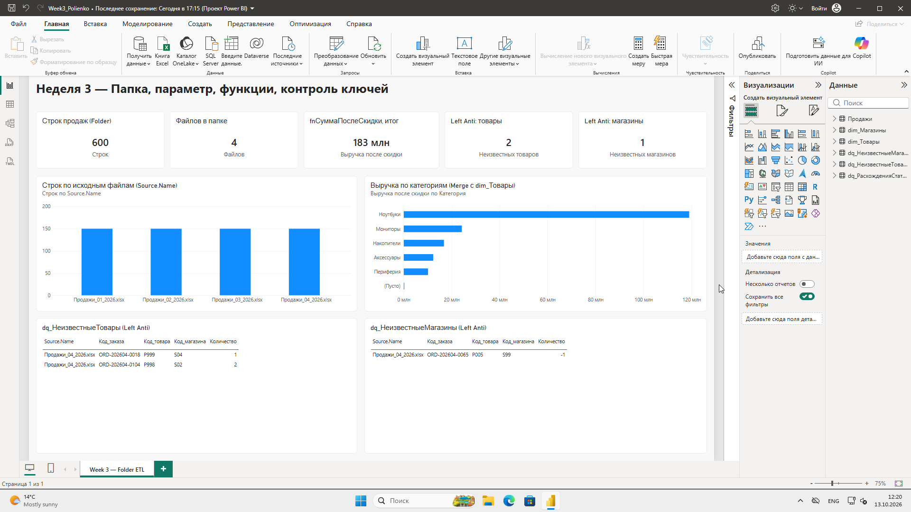
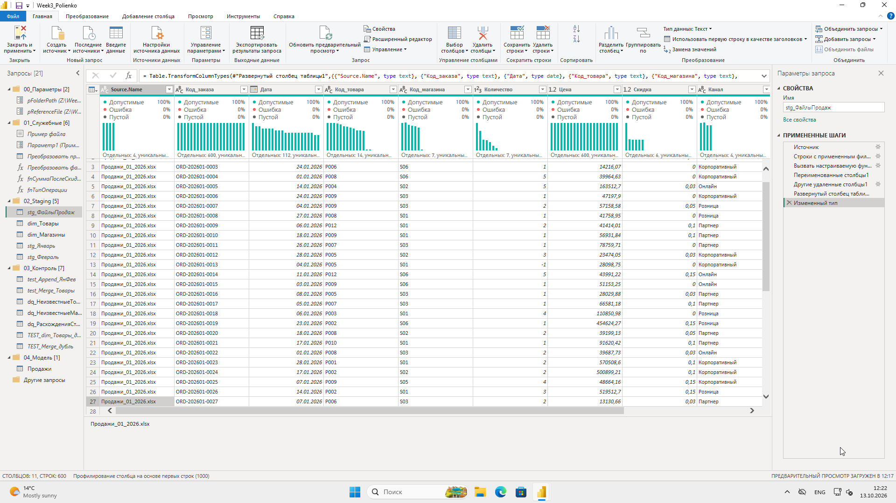
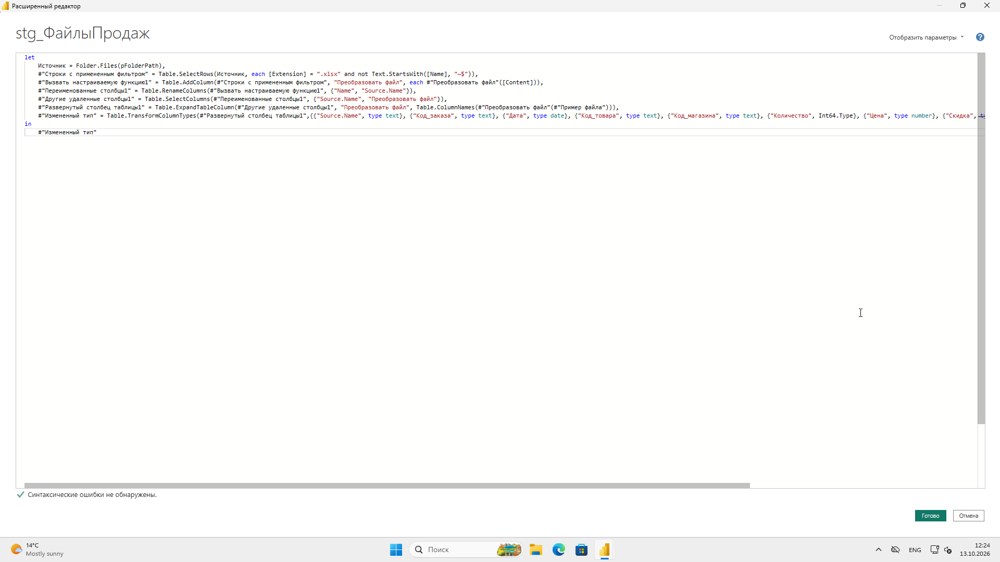
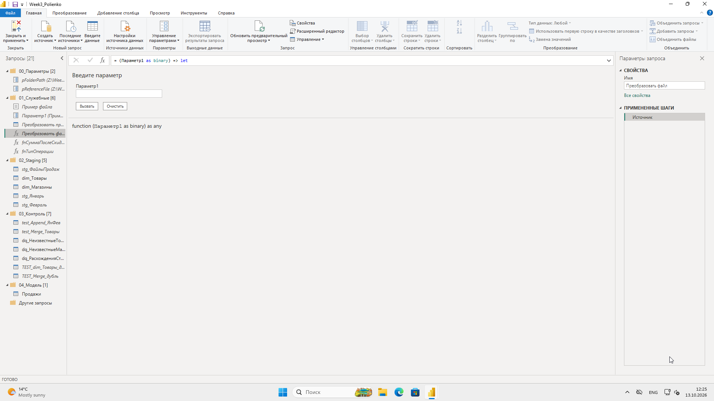
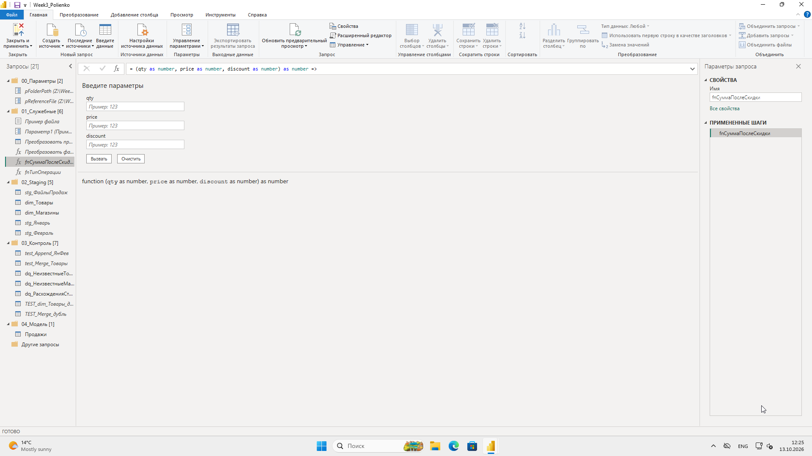
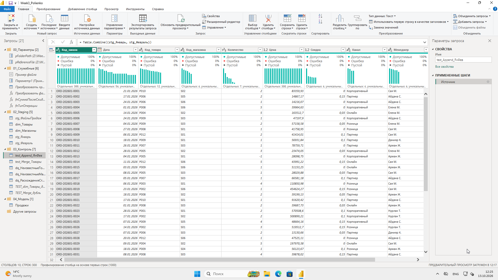
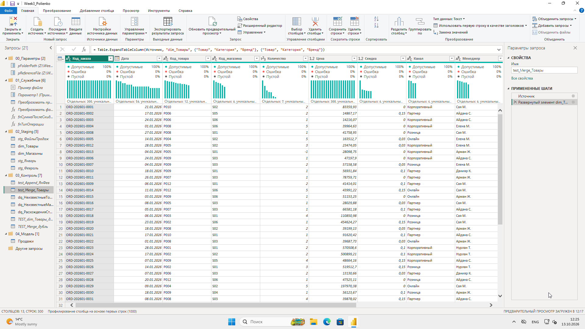
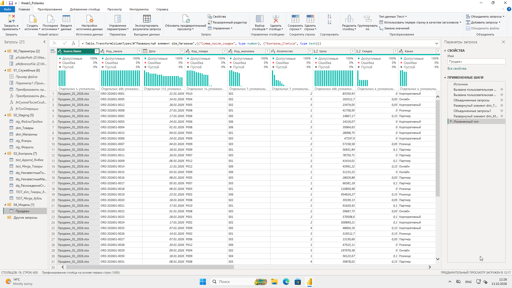
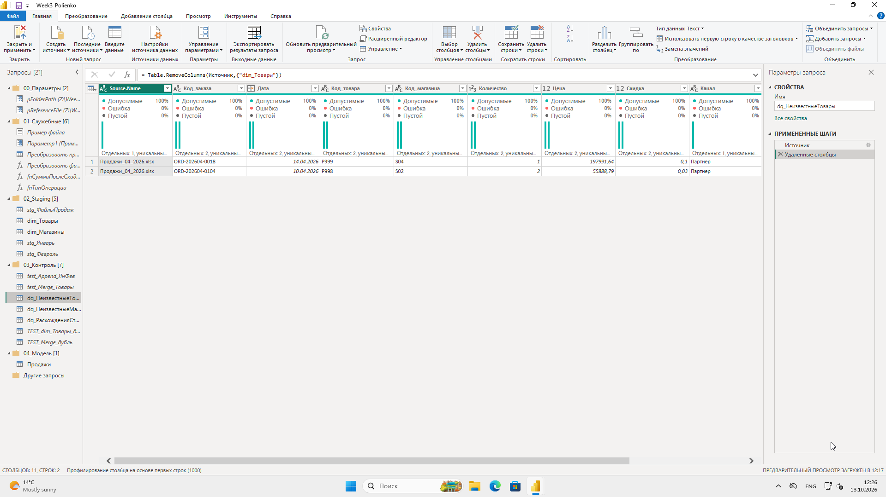
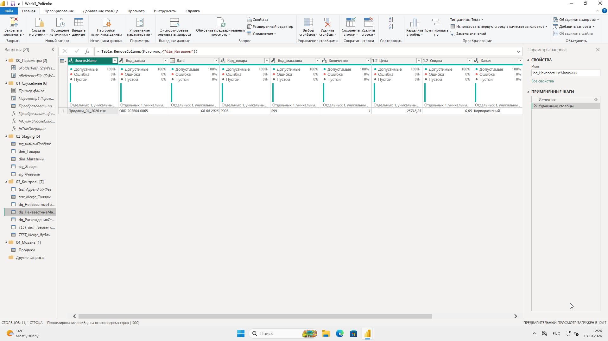
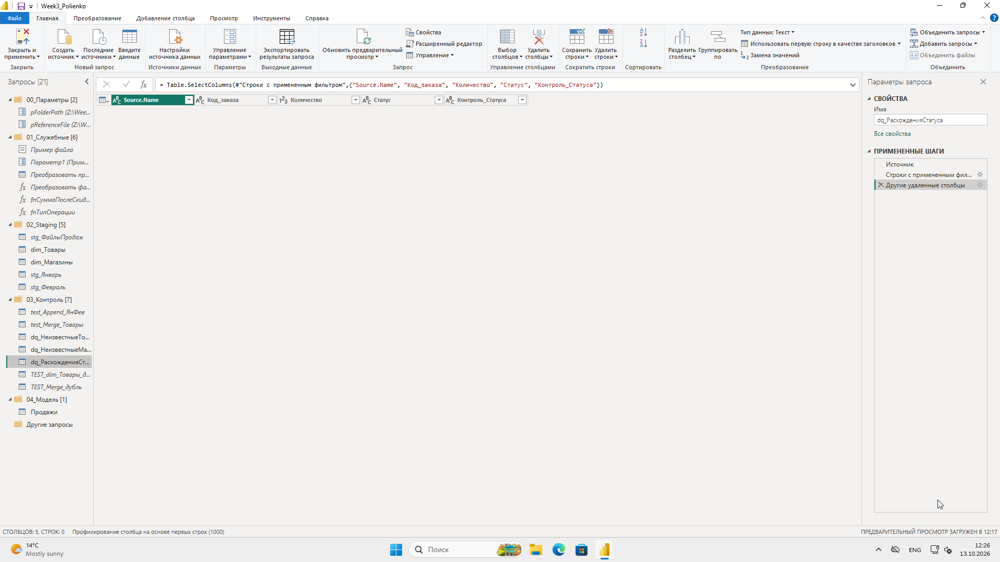
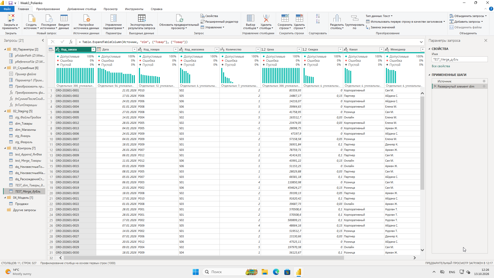
