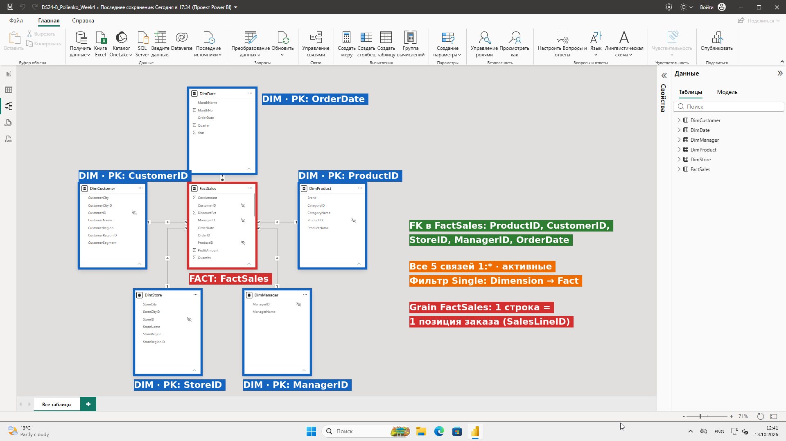
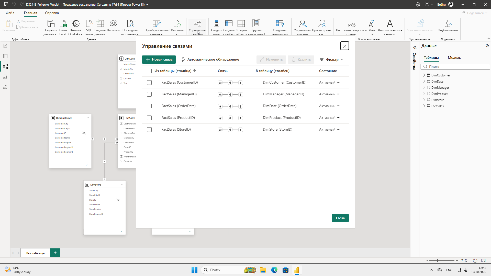
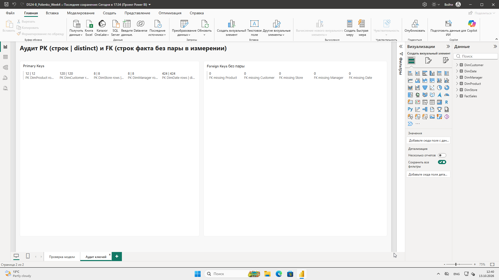
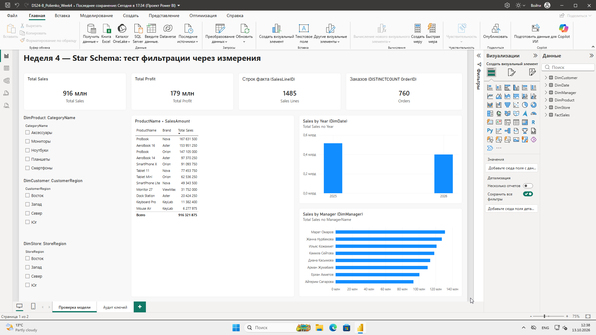
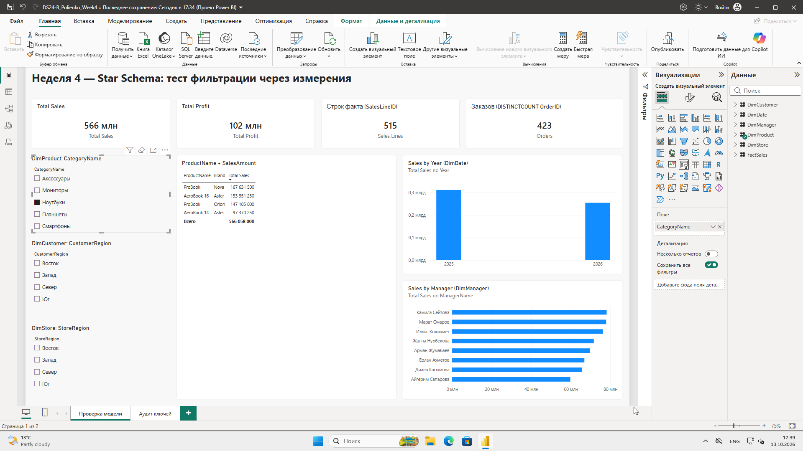
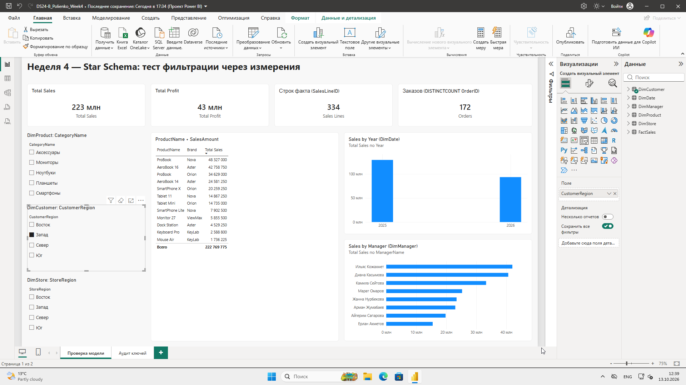
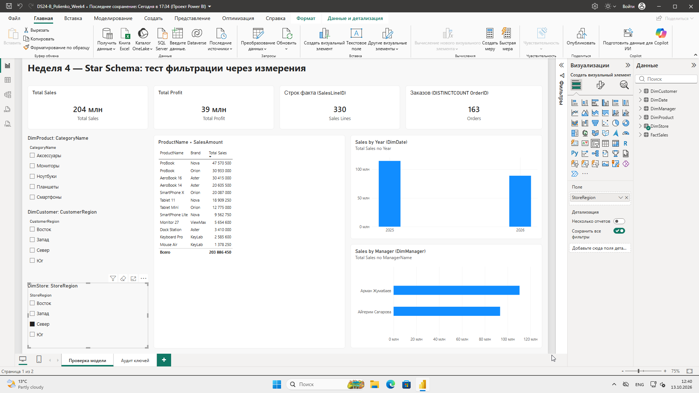

# Практическая работа №4 + СРСП №4. Продвинутое моделирование данных: Flat Table → Star Schema

**Студент:** Полиенко Илья, группа DS 24-Б
**Файл проекта:** `DS24-B_Polienko_Week4.pbix`
**Источник:** `PowerBI_Week4_Flat_Sales_Student.xlsx`, лист Sales_Flat: 1485 строк, 29 столбцов.

## Часть I. Практика

### Задание 1. Staging-запрос

- **Подключение.** «Получить данные → Excel» → лист Sales_Flat → «Преобразовать данные».
- **Запрос.** Переименован в `stg_Sales_Flat`. Флажок «Включить загрузку» снят, это промежуточный слой.
- **Параметр.** Путь к файлу вынесен в `pSourceFile`.
- **Типы.**
  - OrderDate — Дата;
  - Quantity — Целое число;
  - UnitPrice, SalesAmount, CostAmount, ProfitAmount — Фиксированное десятичное (валюта);
  - DiscountPct — Процент;
  - все ID — Текст.

### Задание 2. Grain

| Проверка | Ответ |
|---|---|
| Что означает одна строка? | **Одна строка stg_Sales_Flat соответствует одной товарной позиции (строке) заказа:** один товар в одном заказе, с количеством, ценой, скидкой, суммой, себестоимостью и прибылью |
| Может ли OrderID повторяться? | Да. В одном заказе бывает несколько товаров, и каждый товар — отдельная строка. Из 760 заказов 470 содержат больше одной позиции |
| Какой столбец однозначно идентифицирует строку? | **SalesLineID**: 1485 строк, 1485 различных значений |

**Контроль.** OrderID 100001 встречается трижды:
- SL000001 — P006, SmartPhone Lite;
- SL000002 — P001, AeroBook 14;
- SL000003 — P012.

Товары разные, значит, это три разные позиции одного заказа, а не дубликат. Если удалить повторы по OrderID, пропадут 725 реальных продаж.

### Задание 3. Классификация полей

| Поле | Класс | Таблица | Обоснование |
|---|---|---|---|
| SalesLineID | Technical (PK факта) | FactSales | Уникален для каждой строки, задаёт grain |
| OrderID | Fact (вырожденное измерение) | FactSales | Номер заказа, для DISTINCTCOUNT заказов, не суммируется |
| OrderDate | Dimension key / FK | FactSales → DimDate | Дата события, ключ к календарю |
| ProductID | Technical (FK / PK) | FactSales, DimProduct | Ключ товара |
| ProductName | Dimension | DimProduct | Описание товара, неуникально (ProBook) |
| CategoryID | Technical | DimProduct | Код категории |
| CategoryName | Dimension | DimProduct | Группировка товаров |
| Brand | Dimension | DimProduct | Атрибут товара |
| CustomerID | Technical (FK / PK) | FactSales, DimCustomer | Ключ клиента |
| CustomerName | Dimension | DimCustomer | Описание, неуникально |
| CustomerSegment | Dimension | DimCustomer | Сегмент клиента (Retail и др.) |
| CustomerCity / CustomerCityID | Dimension / Technical | DimCustomer | Город клиента |
| CustomerRegion / CustomerRegionID | Dimension / Technical | DimCustomer | Регион клиента |
| StoreID | Technical (FK / PK) | FactSales, DimStore | Ключ магазина |
| StoreName, StoreCity, StoreRegion | Dimension | DimStore | Описание магазина и его география |
| ManagerID | Technical (FK / PK) | FactSales, DimManager | Ключ менеджера |
| ManagerName | Dimension | DimManager | Имя менеджера |
| Quantity | Measure candidate | FactSales | Аддитивное количество |
| UnitPrice | Fact (неаддитивный) | FactSales | Цена единицы: суммировать нельзя, только среднее или взвешенное |
| DiscountPct | Fact (неаддитивный) | FactSales | Процент: суммировать нельзя |
| SalesAmount | Measure candidate | FactSales | Выручка → Total Sales |
| CostAmount | Measure candidate | FactSales | Себестоимость |
| ProfitAmount | Measure candidate | FactSales | Прибыль → Total Profit |

### Задания 4–9. Таблицы через «Ссылка»

Каждая таблица — Reference от `stg_Sales_Flat`, затем «Удалить другие столбцы» и «Удалить дубликаты» **по ключу**.

| Таблица | Столбцы | Удаление дубликатов по | Строк |
|---|---|---|---|
| DimProduct | ProductID, ProductName, CategoryID, CategoryName, Brand | ProductID | **12** |
| DimCustomer | CustomerID, CustomerName, CustomerSegment, CustomerCityID, CustomerCity, CustomerRegionID, CustomerRegion | CustomerID | **120** |
| DimStore | StoreID, StoreName, StoreCityID, StoreCity, StoreRegionID, StoreRegion | StoreID | **8** |
| DimManager | ManagerID, ManagerName | ManagerID | **8** |
| DimDate | OrderDate + Year, MonthNo, MonthName, Quarter (Добавление столбца → Дата) | OrderDate | **424** (01.01.2025–31.08.2026) |
| FactSales | SalesLineID, OrderID, OrderDate, ProductID, CustomerID, StoreID, ManagerID, Quantity, UnitPrice, DiscountPct, SalesAmount, CostAmount, ProfitAmount | — (дубликаты не удаляются) | **1485** |

Ловушки, найденные в данных:
- **ProductName «ProBook»** принадлежит двум товарам: P003 (бренд Orion) и P004 (бренд Nova). Поэтому по ProductName дубликаты не удалялись: потерялся бы целый товар. В отчёте видно две строки ProBook: 167,6 млн и 147,1 млн.
- **CustomerName.** У 19 имён несколько разных CustomerID. Например, «Марат Жумабаев» — это CU008, CU095 и CU107, а «Асем Тулеген» — CU004, CU049 и CU071. Из 120 клиентов различных имён только 97.

**Почему CustomerName не может быть PK.** Имя — описательный атрибут, а не идентификатор. Полные тёзки существуют, имя может измениться или быть записано с ошибкой. Связь по имени объединила бы покупки разных людей и не дала бы построить связь 1:*, потому что сторона «1» оказалась бы неуникальной.

### Задание 10. Загрузка

Загрузка включена у FactSales и пяти Dim, отключена у stg_Sales_Flat и pSourceFile. Выполнено «Закрыть и применить».

### Задания 11–12. Star Schema

| Сторона «1» | Сторона «*» | Кардинальность | Фильтр | Активна |
|---|---|---|---|---|
| DimProduct[ProductID] | FactSales[ProductID] | 1:* | Одно (Dim → Fact) | Да |
| DimCustomer[CustomerID] | FactSales[CustomerID] | 1:* | Одно | Да |
| DimStore[StoreID] | FactSales[StoreID] | 1:* | Одно | Да |
| DimManager[ManagerID] | FactSales[ManagerID] | 1:* | Одно | Да |
| DimDate[OrderDate] | FactSales[OrderDate] | 1:* | Одно | Да |

Связей Dim → Dim и Fact → Fact нет. Расположение в модели (скриншот 06):
- FactSales в центре;
- DimDate сверху;
- DimProduct справа;
- DimCustomer слева;
- DimStore и DimManager снизу.

Скриншот 07 — окно «Управление связями»: 5 активных связей `* — 1`.

## Часть II. СРСП

### Задание 13. Аудит Primary Keys (скриншот 05)

| Dimension | PK | Строк | Distinct PK | Результат |
|---|---|---|---|---|
| DimProduct | ProductID | 12 | 12 | ✅ уникален, пустых нет |
| DimCustomer | CustomerID | 120 | 120 | ✅ |
| DimStore | StoreID | 8 | 8 | ✅ |
| DimManager | ManagerID | 8 | 8 | ✅ |
| DimDate | OrderDate | 424 | 424 | ✅ |

Проверка встроена в отчёт мерами `COUNTROWS(Dim) & " | " & DISTINCTCOUNT(Dim[PK])`, страница «Аудит ключей».

### Задание 14. Аудит Foreign Keys

| FK в FactSales | Dimension | Типы совпадают? | Отсутствующие ключи |
|---|---|---|---|
| ProductID | DimProduct | Да, Текст = Текст | **0** |
| CustomerID | DimCustomer | Да, Текст | **0** |
| StoreID | DimStore | Да, Текст | **0** |
| ManagerID | DimManager | Да, Текст | **0** |
| OrderDate | DimDate | Да, Дата | **0** |

Проверка: мера `COUNTROWS(FILTER(FactSales, ISBLANK(RELATED(Dim[PK]))))` для каждого измерения. Все пять мер равны 0, в срезах нет элемента «(Пусто)». Так и должно быть: измерения построены из тех же строк, что и факт.

### Задание 15. Скрытие и форматы

- **Скрыты.**
  - ProductID, CustomerID, StoreID, ManagerID — в факте и в измерениях;
  - SalesLineID.
- **Не скрыты.** ProductName, CategoryName, Brand, CustomerName, CustomerSegment, города, регионы, StoreName, ManagerName.
- **Суммирование.** У OrderID — «Не суммировать».
- **Форматы.**
  - Quantity — целое;
  - UnitPrice, SalesAmount, CostAmount, ProfitAmount — `#,0`;
  - DiscountPct — процент.
- **Сортировка.** MonthName сортируется по MonthNo, ключом он не служит.

### Задание 16. Тест фильтрации (скриншоты 01–04)

| Фильтр | Путь | Total Sales | Строк факта | Заказов |
|---|---|---|---|---|
| Без фильтра | — | 916,3 млн | 1485 | 760 |
| CategoryName = Ноутбуки | DimProduct → FactSales | 566 млн | 515 | 423 |
| CustomerRegion = Запад | DimCustomer → FactSales | 223 млн | 334 | 172 |
| StoreRegion = Север | DimStore → FactSales | 204 млн | 330 | 163 |

Каждый срез фильтрует факт через своё измерение, все визуалы пересчитываются согласованно. При StoreRegion = Север на графике менеджеров остаются только 2 менеджера: в магазинах региона работают только они.

### Задание 17. Схема Star Schema

Скриншот 06 (Model View с подписями). На нём отмечены:
- FACT FactSales;
- 5 DIM с PK;
- FK в FactSales;
- 1:*;
- фильтр Single Dim → Fact;
- grain.

```
                    DimDate (PK OrderDate)
                          │ 1
                          ▼ *
DimCustomer ──1──►*  FactSales  *◄──1── DimProduct
(PK CustomerID)   FK: ProductID, CustomerID,   (PK ProductID)
                  StoreID, ManagerID, OrderDate
                  Grain: 1 строка = 1 позиция заказа
                    *▲          ▲*
                    1│          │1
             DimStore (PK StoreID)   DimManager (PK ManagerID)
```

### Задание 18. Спецификация модели

| Таблица | Тип | Grain | PK | FK | Атрибуты / меры |
|---|---|---|---|---|---|
| FactSales | Fact | 1 строка = 1 позиция заказа | SalesLineID | ProductID, CustomerID, StoreID, ManagerID, OrderDate | Quantity, UnitPrice, DiscountPct, SalesAmount, CostAmount, ProfitAmount; меры Total Sales, Total Profit, Sales Lines, Orders |
| DimProduct | Dimension | 1 строка = 1 товар (ProductID) | ProductID | — | ProductName, CategoryID, CategoryName, Brand |
| DimCustomer | Dimension | 1 строка = 1 клиент (CustomerID) | CustomerID | — | CustomerName, CustomerSegment, CustomerCity, CustomerRegion (+ID) |
| DimStore | Dimension | 1 строка = 1 магазин (StoreID) | StoreID | — | StoreName, StoreCity, StoreRegion (+ID) |
| DimManager | Dimension | 1 строка = 1 менеджер (ManagerID) | ManagerID | — | ManagerName |
| DimDate | Dimension | 1 строка = 1 календарная дата с продажами | OrderDate | — | Year, MonthNo, MonthName, Quarter |

### Задание 19. Обоснование grain (178 слов)

Одна строка FactSales — это одна товарная позиция заказа: конкретный товар в конкретном заказе с его количеством, ценой, скидкой, выручкой, себестоимостью и прибылью. OrderID повторяется, потому что заказ — это «шапка», а позиций в нём может быть несколько. Например, в заказе 100001 три разных товара, и это три строки, а не дубликаты. SalesLineID уникален, так как присваивается каждой позиции отдельно: 1485 строк и 1485 значений. Поэтому он служит ключом строки факта.

Если смешать в одной таблице строки уровня «позиция заказа» и строки уровня «итог заказа», каждая сумма попадёт в таблицу дважды: сначала по позициям, затем итогом. SUM(SalesAmount) завысится примерно вдвое, а COUNTROWS перестанет означать что-либо определённое.

При едином grain меры однозначны:
- SUM(SalesAmount) — выручка;
- COUNTROWS(FactSales) — число проданных позиций (1485);
- DISTINCTCOUNT(OrderID) — число заказов (760);
- средний чек = выручка / DISTINCTCOUNT(OrderID).

Будущие DAX-меры можно писать без поправок на «смешанные» строки, и фильтры по измерениям будут работать корректно.

### Задание 20. Star Schema против плоской таблицы (226 слов)

Плоская таблица Sales_Flat повторяет описание товара, клиента, магазина и менеджера в каждой из 1485 строк. Например, название и бренд товара хранятся сотни раз, хотя товаров всего 12. В Star Schema каждый атрибут хранится один раз в своём измерении, а факт содержит только ключи и числа. Это уменьшает размер модели и упрощает поддержку: чтобы переименовать категорию, достаточно изменить одну строку DimProduct.

Бизнес-логика становится понятнее. FactSales отвечает на вопрос «что произошло и сколько», измерения — «кто, что, где, когда». Пользователь в панели полей видит понятные группы атрибутов, а технические ID скрыты.

Фильтрация предсказуема. Фильтр идёт от измерения к факту по связям 1:* в одном направлении, поэтому срез по категории, региону клиента или региону магазина однозначно отбирает строки продаж. В плоской таблице появляются двусмысленности: например, City клиента и City магазина — это разные поля с одинаковым смыслом.

DAX проще. Меры пишутся над одной таблицей фактов (SUM, DISTINCTCOUNT), а измерения дают контекст. Календарь DimDate позволяет в дальнейшем использовать функции Time Intelligence.

Риск двойного подсчёта ниже. Grain факта зафиксирован, а измерения уникальны по ключу, поэтому связь не размножает строки. В плоской таблице ошибочное удаление дубликатов по OrderID или по ProductName (ProBook) незаметно исказило бы выручку. Звезда — стандарт моделирования, на который рассчитан движок VertiPaq.

### Задание 21. Мини-аудит модели

| Риск | Как проверить | Результат |
|---|---|---|
| Неуникальный PK | COUNTROWS = DISTINCTCOUNT(PK) для каждого Dim | ✅ Проверено: 12/12, 120/120, 8/8, 8/8, 424/424 |
| Неправильный grain | Уникальность SalesLineID, разбор повторов OrderID | ✅ 1485 = 1485, повторы OrderID — разные товары |
| Связь *:* вместо 1:* | «Управление связями»: значки `* — 1` | ✅ Все 5 связей 1:* |
| Both вместо Single без причины | Стрелка направления на линии связи / «Изменить связь» | ✅ Везде одно направление Dim → Fact |
| Технические ID видны пользователю | Значок «скрыто» в Model View | ✅ ProductID, CustomerID, StoreID, ManagerID, SalesLineID скрыты |
| FK без пары в измерении | Меры ISBLANK(RELATED(...)) | ✅ 0 во всех пяти |
| Дубликаты по описательному полю | Сравнить DISTINCTCOUNT(ProductName) и ProductID | ✅ 11 имён на 12 ID, удаление шло по ID |

## Ответы на вопросы защиты

1. **Grain FactSales** — одна строка соответствует одной позиции заказа, то есть одному товару в одном заказе.
2. **Почему OrderID повторяется и не является PK.** В заказе несколько товаров. PK факта — SalesLineID.
3. **Почему не ProductName вместо ProductID.** Название неуникально: ProBook — это P003 у Orion и P004 у Nova. Связь по имени смешала бы два разных товара.
4. **Почему CustomerName — ненадёжный PK.** Бывают тёзки (19 имён у разных ID), имя может меняться или записываться с ошибками.
5. **PK и FK.** PK — уникальный ключ строки таблицы. FK — поле, которое ссылается на PK другой таблицы.
6. **Почему сторона «1» должна быть уникальной.** Иначе один ключ факта совпадёт с несколькими строками измерения: связь станет *:* или размножит данные.
7. **Что такое 1:*.** Одной строке измерения соответствует много строк факта.
8. **Почему фильтр идёт Dimension → Fact.** Пользователь выбирает атрибут (категорию, регион), и он должен отобрать продажи. Обратная фильтрация обычно не нужна и даёт неоднозначные пути.
9. **Почему не Both без необходимости.** Двунаправленный фильтр создаёт неоднозначность при нескольких путях, замедляет модель и может давать неожиданные результаты.
10. **Fact и Dimension.** Fact содержит события и числа, строк в нём много. Dimension содержит описательный контекст, ключи в нём уникальны, строк мало.
11. **Какие поля скрыты.** Технические ID (ProductID, CustomerID, StoreID, ManagerID, SalesLineID): пользователю отчёта они не нужны, а описательные поля их заменяют.
12. **Что будет при удалении дубликатов Sales_Flat по OrderID.** Останется 760 строк вместо 1485, то есть потеряется 725 реальных позиций, и выручка занизится.
13. **Почему несколько таблиц лучше одной широкой.** Нет повторов, проще и надёжнее фильтры и DAX, понятные поля, меньше размер, ниже риск двойного подсчёта.
14. **Star и Snowflake.** В Star измерения денормализованы: категория и регион лежат прямо в DimProduct и DimCustomer. В Snowflake их выносят в отдельные таблицы (DimCategory, DimRegion), которые связаны с измерениями. Получается цепочка связей.
15. **Пять проверок перед защитой.** Уникальность PK, пустые FK, тип и направление связей, grain факта, скрытие технических полей. Плюс тест фильтрации через три измерения.

## Скриншоты

| № | Файл |
|---|---|
| 01 | 01_Отчёт_без_фильтров.png — 916 млн, 1485 строк, 760 заказов |
| 02 | 02_Фильтр_CategoryName_Ноутбуки.png |
| 03 | 03_Фильтр_CustomerRegion_Запад.png |
| 04 | 04_Фильтр_StoreRegion_Север.png |
| 05 | 05_Аудит_PK_FK.png |
| 06 | 06_Star_Schema_Model_View.png — Star Schema с подписями |
| 07 | 07_Управление_связями_1ко_многим_Single.png |








