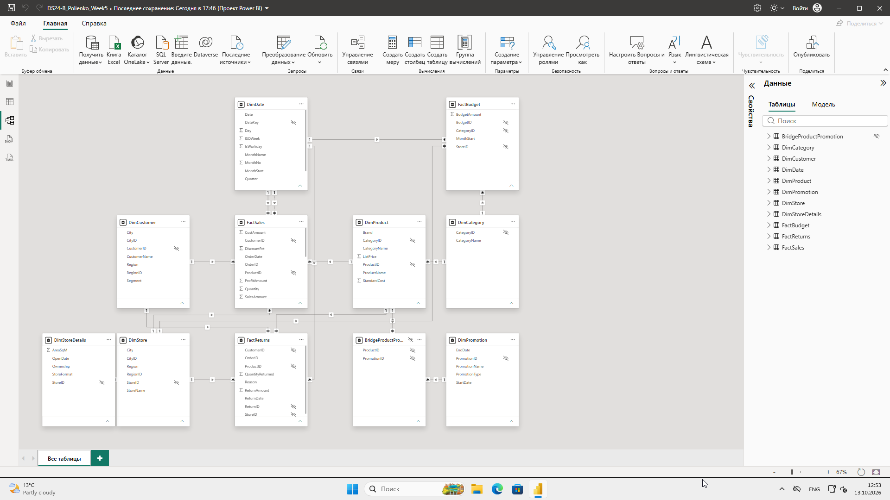
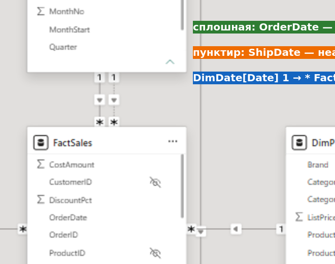
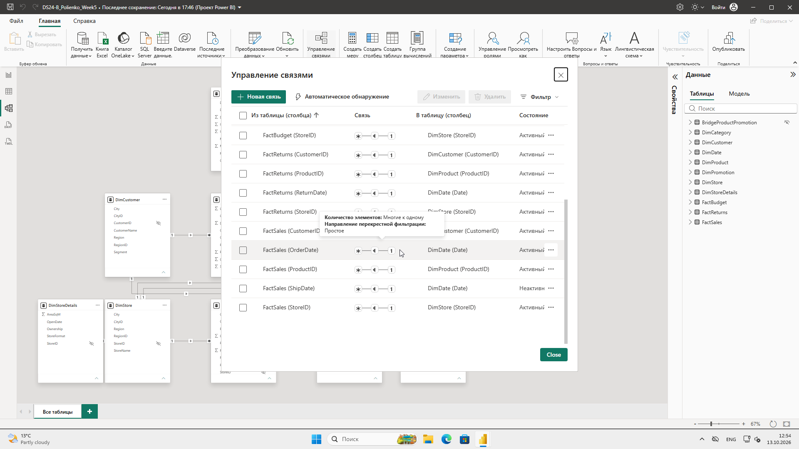
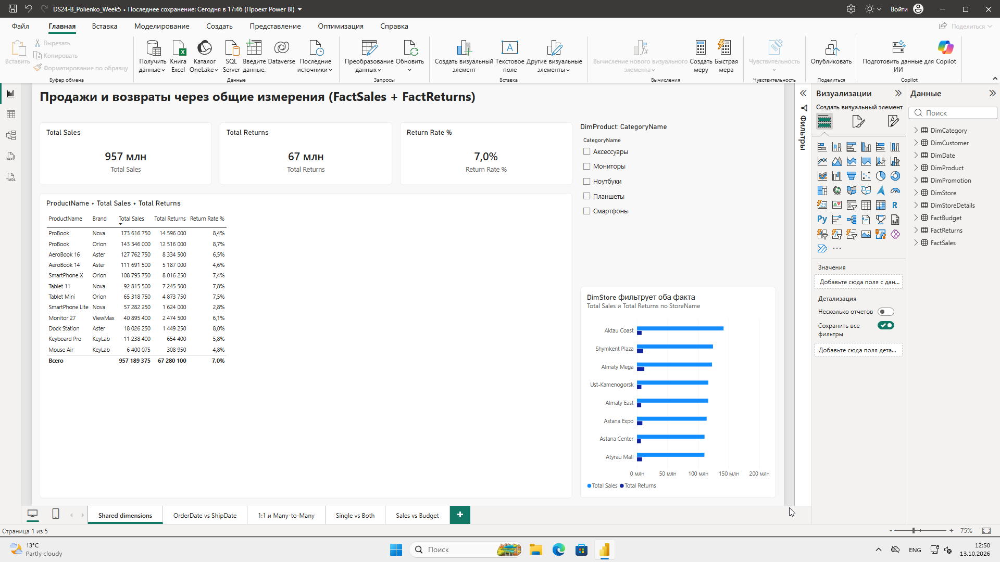
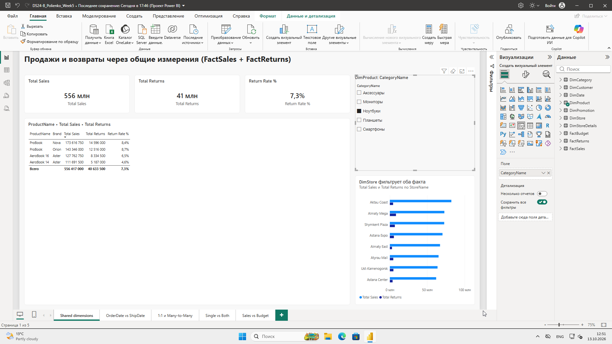
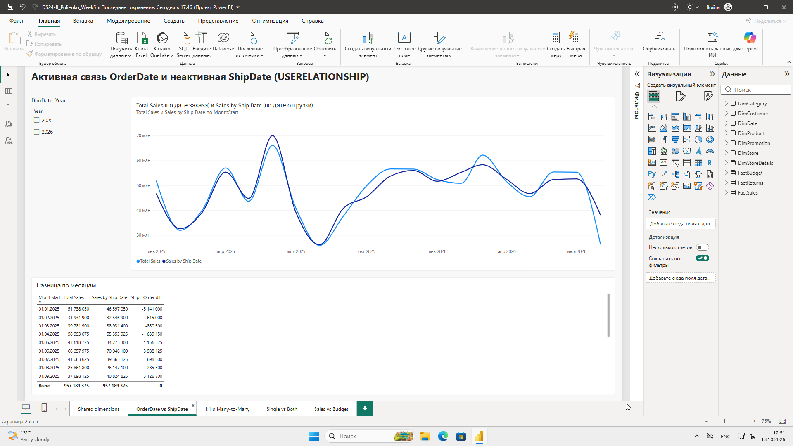
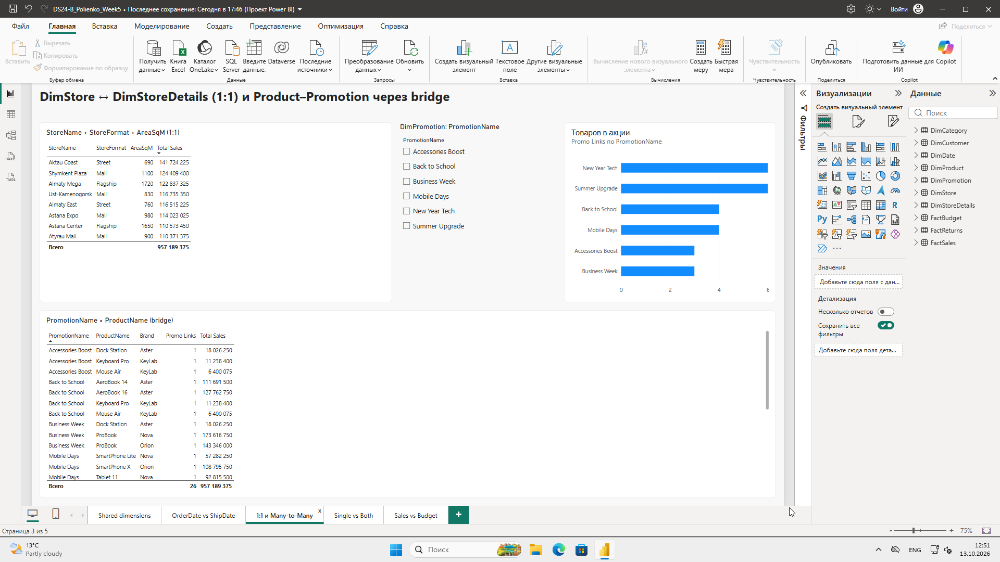
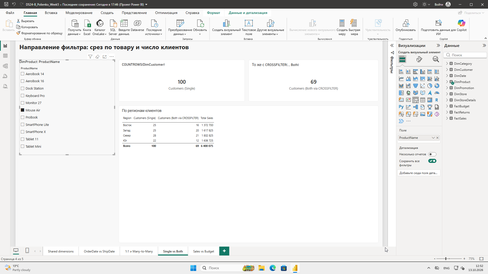
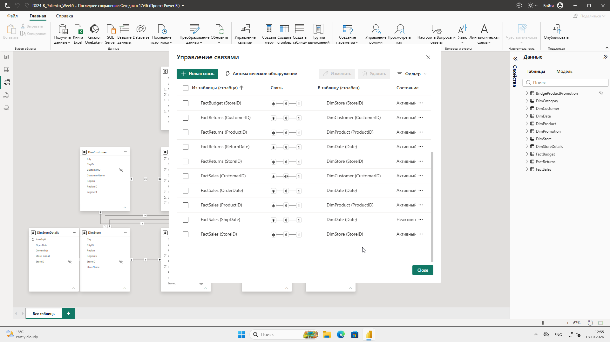
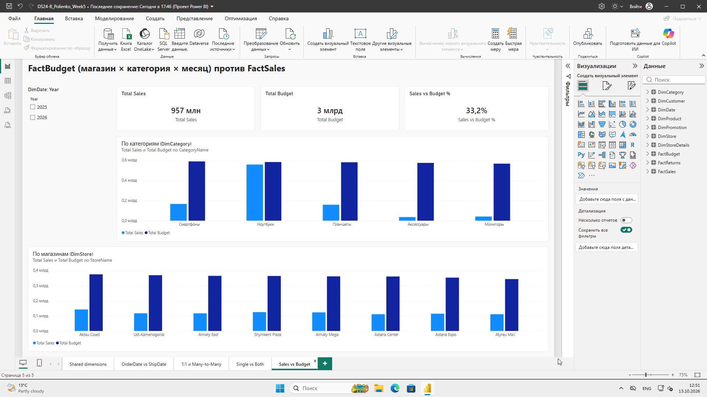

# Практическая работа №5 + СРСП №5. Продвинутые связи и фильтрация модели

**Студент:** Полиенко Илья, группа DS 24-Б
**Файл проекта:** `DS24-B_Polienko_Week5.pbix`
**Источник:** `PowerBI_Week5_Relationships_Dataset.xlsx`. Загружены 11 таблиц, все листы кроме 00_README и Data_Dictionary. Путь к файлу задан параметром `pSourceFile`.

## 1. Архитектура

### Задание 2. Grain

| Таблица | Grain | Строк |
|---|---|---|
| FactSales | 1 строка = 1 товарная позиция заказа (SalesLineID) | 1577 (820 заказов) |
| FactReturns | 1 строка = 1 возвращённая позиция (ReturnID) | 210 |
| FactBudget | 1 строка = магазин × категория × месяц (BudgetID) | 800 = 8 магазинов × 5 категорий × 20 месяцев |

Grain различаются, потому что факты описывают разные процессы:
- продажа фиксируется по каждой позиции чека и конкретной дате;
- возврат — по каждой возвращённой позиции, со своей датой и причиной;
- бюджет планируется крупнее: на месяц, магазин и категорию, без товаров, клиентов и дней.

**Можно ли соединять FactSales и FactBudget по ProductID?** Нет. В FactBudget нет ProductID: бюджет задан на категорию, а не на товар. Даже при искусственном ключе каждая строка бюджета сопоставилась бы с сотнями продаж, и бюджет многократно повторился бы в сумме. Сравнивать продажи и бюджет можно только через общие измерения на уровне более крупного grain: DimStore, DimCategory, DimDate (месяц).

### Задание 3. Ключи (на стороне Dimension)

| Dimension | PK | Строк | Distinct | Пустые |
|---|---|---|---|---|
| DimProduct | ProductID | 12 | 12 | 0 |
| DimCustomer | CustomerID | 100 | 100 | 0 |
| DimStore | StoreID | 8 | 8 | 0 |
| DimStoreDetails | StoreID | 8 | 8 | 0 |
| DimPromotion | PromotionID | 6 | 6 | 0 |
| DimDate | Date | 608 (01.01.2025–31.08.2026) | 608 | 0 |
| DimCategory | CategoryID | 5 | 5 | 0 |

Ключевые проверки:
- **FK.** Во всех фактах FK без пропусков: каждый ProductID, CustomerID и StoreID есть в своём измерении.
- **Даты.** Все OrderDate и ShipDate есть в DimDate.
- **Ловушка с ProductName.** «ProBook» — это два товара, P003 и P004. Поэтому ключом служит ProductID, а не название.

### Итоговая модель (скриншот 07)

| Связь (1 → *) | Тип | Фильтр | Состояние |
|---|---|---|---|
| DimProduct → FactSales | 1:* | Одно | Активна |
| DimCustomer → FactSales | 1:* | Одно | Активна |
| DimStore → FactSales | 1:* | Одно | Активна |
| DimDate[Date] → FactSales[OrderDate] | 1:* | Одно | **Активна** |
| DimDate[Date] → FactSales[ShipDate] | 1:* | Одно | **Неактивна** (пунктир) |
| DimProduct → FactReturns | 1:* | Одно | Активна |
| DimCustomer → FactReturns | 1:* | Одно | Активна |
| DimStore → FactReturns | 1:* | Одно | Активна |
| DimDate[Date] → FactReturns[ReturnDate] | 1:* | Одно | Активна |
| DimStore ↔ DimStoreDetails | **1:1** | Оба (для 1:1 обязательно) | Активна |
| DimProduct → BridgeProductPromotion | 1:* | **Оба** (обоснованно, см. ниже) | Активна |
| DimPromotion → BridgeProductPromotion | 1:* | Одно | Активна |
| DimCategory → DimProduct | 1:* | Одно | Активна |
| DimCategory → FactBudget | 1:* | Одно | Активна |
| DimStore → FactBudget | 1:* | Одно | Активна |
| DimDate[Date] → FactBudget[MonthStart] | 1:* | Одно | Активна |

Прямых связей Fact ↔ Fact нет. Технические ключи скрыты от пользователя. Мост BridgeProductPromotion целиком скрыт: в нём только ключи.

## 2. Shared dimensions (задания 5–8)

FactSales и FactReturns подключены к одним и тем же DimProduct, DimCustomer, DimStore и DimDate. Меры:

```
Total Sales   = SUM(FactSales[SalesAmount])
Total Returns = SUM(FactReturns[ReturnAmount])
Return Rate % = DIVIDE([Total Returns], [Total Sales])
```

**Тест (скриншоты 01–02).** Без фильтра: Total Sales 957,2 млн, Total Returns 67,3 млн, Return Rate 7,0 %. Срез CategoryName = «Ноутбуки» одновременно меняет оба факта: 556,4 млн продаж и 40,6 млн возвратов (7,3 %). В таблице остаются 4 ноутбука, в том числе оба ProBook отдельными строками. Диаграмма по магазинам тоже фильтрует оба факта. Значит, DimProduct и DimStore работают как shared dimensions.

### Задание 8. Почему нельзя Fact-to-Fact

Неправильная схема:

```
FactSales ──*:*── FactReturns     (например, по OrderID или ProductID)
```

Риски прямой связи:
1. **Кардинальность *:*.** OrderID и ProductID не уникальны ни в одной из таблиц. Связь получается «многие ко многим», и суммы размножаются по совпадающим строкам.
2. **Неправильный разрез.** Фильтр по товару доходил бы до возвратов не через товар, а через продажи. Возврат без пары в продажах (например, другой период) пропал бы из отчёта.
3. **Неоднозначные пути.** Если оба факта уже связаны с DimProduct, связь Fact ↔ Fact создаёт второй путь фильтра, и Power BI отключит одну из связей или выберет путь неявно.
4. **Сложный DAX.** Меры начинают зависеть от направления фильтра между фактами, приходится вводить CROSSFILTER и TREATAS.

Общая Dimension безопаснее. У неё уникальный ключ, фильтр идёт однозначно 1 → *, и каждый факт агрегируется независимо в своём grain, а результаты сопоставляются по общему атрибуту (товар, магазин, дата).

## 3. Active / Inactive и USERELATIONSHIP (задания 9–12, кейс 1)

- **OrderDate.** DimDate[Date] → FactSales[OrderDate] — активная связь, сплошная линия.
- **ShipDate.** DimDate[Date] → FactSales[ShipDate] — неактивная, пунктир (скриншоты 08, 10).

**Почему обе связи не могут быть активными.** Между DimDate и FactSales тогда два пути, и при выборе месяца непонятно, что фильтровать: дату заказа или дату отгрузки. Power BI разрешает только одну активную связь между парой таблиц. Вторую включают в нужной мере явно:

```
Sales by Ship Date =
CALCULATE(
    [Total Sales],
    USERELATIONSHIP(DimDate[Date], FactSales[ShipDate])
)
```

DimDate здесь — **role-playing dimension**: одна таблица играет роли «Дата заказа» и «Дата отгрузки».

**Сравнение по месяцам (скриншот 03).** Линейный график по DimDate[MonthStart] со срезом Year, плюс таблица разницы.

| Месяц | Total Sales (по заказу) | Sales by Ship Date | Разница |
|---|---|---|---|
| Август 2026 | 26,4 млн | 38,2 млн | **+11,8 млн** |
| Январь 2025 | 51,7 млн | 46,6 млн | −5,1 млн |
| Февраль 2026 | 50,8 млн | 55,3 млн | +4,4 млн |
| Октябрь 2025 | 49,8 млн | 45,4 млн | −4,4 млн |
| Июнь 2025 | 66,1 млн | 70,0 млн | +4,0 млн |
| Март 2026 | 62,2 млн | 58,3 млн | −3,9 млн |

**Выводы:**
1. Отгрузка отстаёт от заказа на 1–7 дней. Поэтому **10,7 % позиций** (169 из 1577) заказаны в одном месяце, а отгружены в следующем. Отсюда расхождение линий в каждом месяце.
2. Сильнее всего расходится **август 2026**, последний месяц данных: по дате заказа 26,4 млн, по дате отгрузки 38,2 млн (+11,8 млн). В август отгружены и заказы конца июля, а отгрузок позже 31.08 в данных нет. По OrderDate август на 31 % ниже, чем по отгрузкам, поэтому для склада и логистики правильнее смотреть Sales by Ship Date.
3. В **январе 2025** продажи по отгрузке на 5,1 млн ниже: заказы последних дней января ушли в феврале. Это граница периода. Перед закрытием месяца «заказано» и «отгружено» нужно сверять отдельно.
4. По году разница небольшая: 2025 — 557,7 млн по заказу и 549,7 млн по отгрузке. Перенос между годами (−8,0 млн / +8,0 млн) важен для годовой отчётности: выручку признают по отгрузке.

## 4. Связь 1:1 (задание 13)

DimStore[StoreID] ↔ DimStoreDetails[StoreID]: StoreID уникален в обеих таблицах (8 и 8), кардинальность «Один к одному», фильтр в обе стороны. В отчёте (скриншот 04) рядом показаны StoreName, StoreFormat, AreaSqM и Total Sales. Например, Aktau Coast — Street, 690 м², 141,7 млн.

**Почему таблицы иногда оставляют раздельными:**
- разные источники и частота обновления: детали магазина ведёт другой отдел или система;
- редко используемые и «тяжёлые» атрибуты не засоряют основное измерение;
- разные права доступа: например, Ownership и площадь видны не всем;
- независимые изменения: один из справочников может расшириться до SCD-истории.

## 5. Many-to-Many через bridge (задания 14–16, кейс 2)

**Grain BridgeProductPromotion:** одна строка — одна уникальная принадлежность товара к акции (ProductID × PromotionID). 26 строк, 26 уникальных пар, повторов нет.

Связи: DimProduct 1:* Bridge и DimPromotion 1:* Bridge. Прямой связи *:* DimProduct ↔ DimPromotion нет.

**Проверка (скриншот 04):**
- **Одна акция → несколько товаров.** New Year Tech и Summer Upgrade — по 6 товаров, Back to School и Mobile Days — по 4, Accessories Boost и Business Week — по 3.
- **Один товар → несколько акций.** 8 товаров участвуют в 2 акциях, 3 товара — в 3 акциях, 1 товар — в одной. Например, AeroBook 14 входит в Back to School и New Year Tech.

**Почему bridge лучше прямой *:*:**
- grain связи явный и проверяемый: видно, какая пара существует, и её можно проверить на дубли;
- обе связи остаются классическими 1:* с уникальной стороной «1»;
- в мост легко добавить атрибуты принадлежности: даты участия товара в акции, размер скидки;
- поведение фильтров прозрачно: направление «Оба» включено только на одной связи моста и только там, где оно нужно.

Связь DimProduct → Bridge двунаправленная, чтобы фильтр по акции проходил Promotion → Bridge → Product → FactSales. Это классический оправданный случай Both. Ограничение: акции не ограничены по датам. Мера Total Sales по акции показывает все продажи товаров, которые в неё входят, за весь период. Для точного анализа нужно ещё условие StartDate–EndDate.

## 6. Single / Both (задание 17)

| Шаг | Что сделано | Результат |
|---|---|---|
| 1 | Связь FactSales[CustomerID] → DimCustomer, исходно «Простое» (скриншот 11) | Срез ProductName = Mouse Air: COUNTROWS(DimCustomer) = **100**. Фильтр не идёт от факта к измерению |
| 2 | Временно «Оба» (скриншот 12) | Power BI разрешил. Тот же срез: COUNTROWS(DimCustomer) = **69**, это клиенты, купившие Mouse Air (скриншот 13) |
| 3 | Проверка побочного эффекта | Появился второй путь DimProduct → FactSales → DimCustomer → FactReturns. Power BI молча выбрал прямой путь, и «Ноутбуки» по-прежнему дают 40,6 млн возвратов (скриншот 14). Модель стала зависеть от неявного выбора пути |
| 4 | Возврат к «Простое» (скриншот 15) | Безопасная конфигурация восстановлена |

Тот же эффект, но без изменения модели, даёт мера с `CROSSFILTER(FactSales[CustomerID], DimCustomer[CustomerID], Both)`. На странице «Single vs Both» она стоит рядом с обычным COUNTROWS: 100 и 69.

### Задание 18. Ambiguous path

```
           ┌──► DimStore ────┐
DimRegion ─┤                 ├──► FactSales      два пути: какой регион фильтрует?
           └──► DimCustomer ─┘
```

Если DimRegion связан и с DimStore, и с DimCustomer, а обе связи до FactSales работают (особенно с Both), фильтр «Регион = Север» может означать как «магазины Севера», так и «клиенты с Севера». Это разные наборы продаж. Чем больше связей Both, тем больше таких альтернативных путей. Power BI либо отключит одну из связей, либо выберет путь неявно, и мера «тихо» изменится после добавления новой связи.

**Безопасная конфигурация:**
- держать регион атрибутом внутри каждого измерения (StoreRegion, CustomerRegion), как в этой модели;
- либо сделать два role-playing измерения региона;
- все связи Dim → Fact оставить Single.

## 7. Аналитическая записка: Single или Both (задание 21)

**Когда Single предпочтителен:**
1. Классическая звезда Dim → Fact: фильтр от атрибута к фактам.
2. Несколько фактов с общими измерениями, как FactSales и FactReturns: Both создал бы путь факт → измерение → другой факт.
3. Ролевые измерения (DimDate с OrderDate и ShipDate): нужна однозначность пути.
4. Большие модели: однонаправленные фильтры быстрее вычисляются.
5. Модели с RLS, где важно, чтобы фильтр безопасности шёл предсказуемо.

**Когда Both оправдан:**
1. Many-to-Many через bridge: связь Product–Bridge, чтобы фильтр по акции доходил до товаров и продаж.
2. Связь 1:1 (DimStore–DimStoreDetails), по сути это одна таблица, разделённая на две.
3. Точечная задача «показать в срезе только значения, у которых есть данные» (например, клиенты, купившие выбранный товар). Лучше решать её мерой с CROSSFILTER, а не связью.

**Риски массового Both:**
1. Неоднозначные пути: Power BI отключает связи или выбирает путь неявно.
2. Числа меняются неожиданно: добавление новой связи меняет результаты старых мер.
3. Падает производительность: фильтры распространяются по всей модели.
4. Сложнее RLS и отладка: фильтр безопасности может «утечь» через факт в другие измерения.
5. Срезы ведут себя непривычно: пропадают значения без данных.

**Моё правило:** по умолчанию все связи Dim → Fact делаются Single. Both ставится только на связи моста M:M и 1:1, и только если без него задача не решается. Если двусторонняя фильтрация нужна одной мере, используется CROSSFILTER внутри CALCULATE, а не изменение связи для всей модели.

## 8. FactBudget с другим grain (задание 22)

**Grain:** магазин × категория × месяц (MonthStart — первое число месяца). Связи:
- DimStore → FactBudget;
- DimCategory → FactBudget;
- DimDate[Date] → FactBudget[MonthStart].

DimCategory одновременно фильтрует DimProduct, а через него и FactSales. Поэтому одна категория задаёт и продажи, и бюджет.

**Почему не по ProductID.** В бюджете нет товаров, он распределён на категорию. Связь по товару невозможна. Если «размазать» бюджет по товарам связью *:*, он повторится для каждого товара категории и завысится в N раз.

**Общие измерения для Sales vs Budget:** DimStore, DimCategory и DimDate на уровне месяца или года, то есть атрибуты не детальнее grain бюджета. Анализ по товару, клиенту или дню для бюджета некорректен: на дате 15-го числа бюджет пуст, так как стоит на 1-м числе.

**Результат (скриншот 06):**

| Категория | Продажи | Бюджет | Выполнение |
|---|---|---|---|
| Ноутбуки | 556,4 млн | 581,4 млн | **95,7 %** |
| Смартфоны | 166,1 млн | 587,2 млн | 28,3 % |
| Планшеты | 158,1 млн | 579,0 млн | 27,3 % |
| Мониторы | 40,9 млн | 565,1 млн | 7,2 % |
| Аксессуары | 35,7 млн | 572,7 млн | 6,2 % |
| **Итого** | **957,2 млн** | **2 885,5 млн** | **33,2 %** |

Бюджет распределён по категориям почти поровну (~575 млн), хотя выручку даёт в основном одна категория. План близок к выполнению только по ноутбукам. Бюджет по остальным категориям выглядит нереалистичным и требует пересмотра.

## 9. Выводы по модели

1. Grain каждого факта определён до связей: позиция продажи, позиция возврата, магазин × категория × месяц. От этого зависит, какие измерения могут фильтровать каждый факт.
2. Shared dimensions (DimProduct, DimStore, DimCustomer, DimDate) позволяют сравнивать продажи и возвраты без связи Fact ↔ Fact. Return Rate 7,0 %, у ProBook (Orion) — 8,7 %.
3. Неактивная связь ShipDate и USERELATIONSHIP дают второй взгляд на ту же выручку, не дублируя таблицу дат. Перенос между месяцами достигает 11,8 млн.
4. Many-to-Many реализована через мост с явным grain. Both включён только на связи моста.
5. Эксперимент с Both показал: Power BI не всегда предупреждает о неоднозначности, он выбирает путь сам. Поэтому безопасная конфигурация по умолчанию — Single.
6. Бюджет можно сравнивать с продажами только на уровне его grain: магазин, категория, месяц.

## 10. Ответы на вопросы защиты (кратко)

1. **1:*.** Одной строке измерения соответствует много строк факта.
2. **1:1.** Каждому ключу одной таблицы соответствует ровно один ключ другой.
3. **Many-to-Many.** Много строк с одной стороны соответствуют многим с другой (товар ↔ акция).
4. **Почему Dimension на стороне 1.** Её ключ уникален, а одно значение атрибута описывает много событий.
5. **Cardinality** — тип соответствия строк связанных таблиц: 1:1, 1:*, *:1, *:*.
6. **Направление фильтрации** — в какую сторону по связи распространяется фильтр.
7. **Single и Both.** Single фильтрует только 1 → *. Both фильтрует и обратно, * → 1.
8. **Почему не Both везде.** Неоднозначные пути, неожиданные результаты, падение скорости, проблемы с RLS.
9. **Active relationship** — связь, которая используется по умолчанию.
10. **Inactive relationship** — связь существует, но работает только через USERELATIONSHIP.
11. **Как выглядит неактивная связь.** Пунктирная линия в Model View.
12. **USERELATIONSHIP** включает неактивную связь внутри CALCULATE для одной меры.
13. **Role-playing dimension** — одно измерение в нескольких ролях (дата заказа, дата отгрузки).
14. **Почему DimDate может играть обе роли.** Обе даты берутся из одного календаря, нужно только выбрать связь.
15. **Bridge table** — таблица пар ключей, которая разбивает *:* на две связи 1:*.
16. **Grain моста** — 1 строка = 1 пара ProductID × PromotionID.
17. **Почему FactSales ↔ FactReturns нежелательна.** Связь *:*, размножение строк, неоднозначность, фильтр через чужой grain.
18. **Shared dimension** — измерение, общее для нескольких фактов.
19. **Ambiguous filter path** — несколько путей фильтра между двумя таблицами.
20. **Если после новой связи мера изменилась.** Проверить пути фильтра, направление (Both), активность связей, кардинальность.
21. **Почему ProductName не ключ.** ProBook — два разных ProductID.
22. **Почему CustomerName не ключ.** Одинаковые имена у разных CustomerID.
23. **FactSales и FactBudget.** У продаж grain позиция × день, у бюджета магазин × категория × месяц.
24. **Когда Both оправдан.** Мост M:M, 1:1, точечные сценарии (лучше через CROSSFILTER).
25. **Почему Single — безопасный вариант по умолчанию.** Однозначные пути, предсказуемые меры, выше скорость.

## Скриншоты

| № | Файл |
|---|---|
| 01 | 01_Shared_dimensions.png |
| 02 | 02_Срез_Ноутбуки_фильтрует_оба_факта.png |
| 03 | 03_OrderDate_vs_ShipDate_USERELATIONSHIP.png |
| 04 | 04_1к1_и_ManyToMany_bridge.png |
| 05 | 05_Single_vs_Both_CROSSFILTER.png |
| 06 | 06_Sales_vs_Budget.png |
| 07 | 07_Model_View_итоговая.png |
| 08 | 08_Active_OrderDate_Inactive_ShipDate.png |
| 09–10 | Управление связями (список, ShipDate — неактивна) |
| 11–15 | Эксперимент Single → Both → Single |












