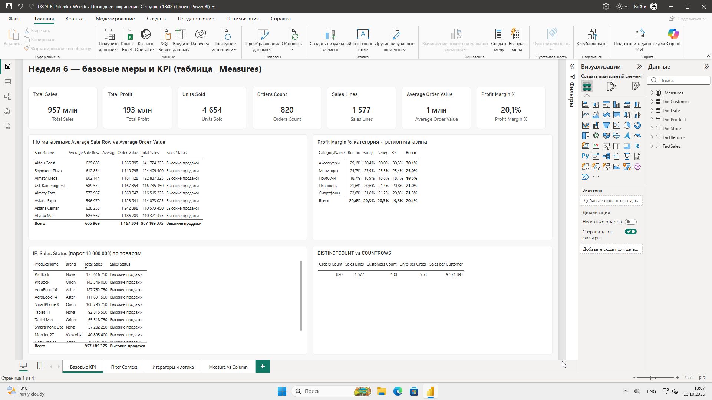
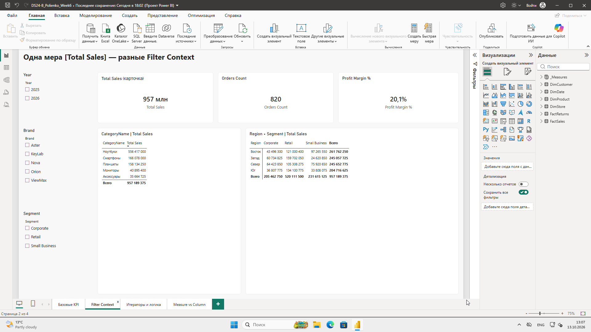
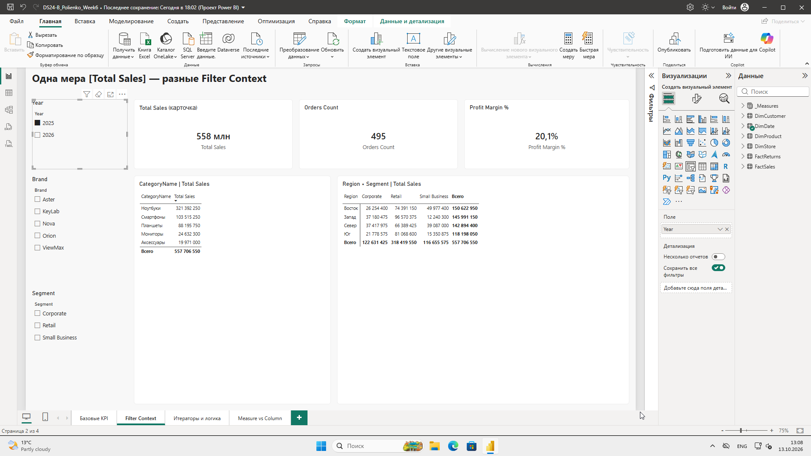
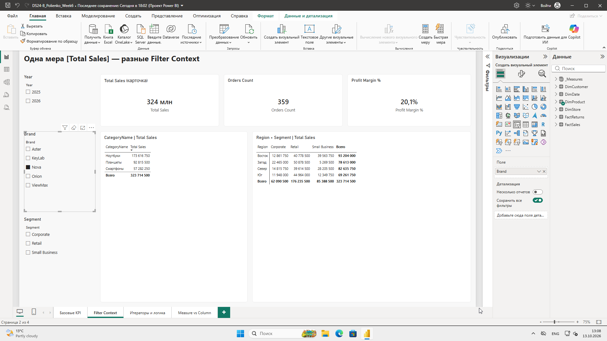
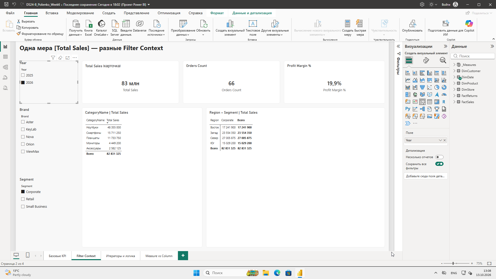
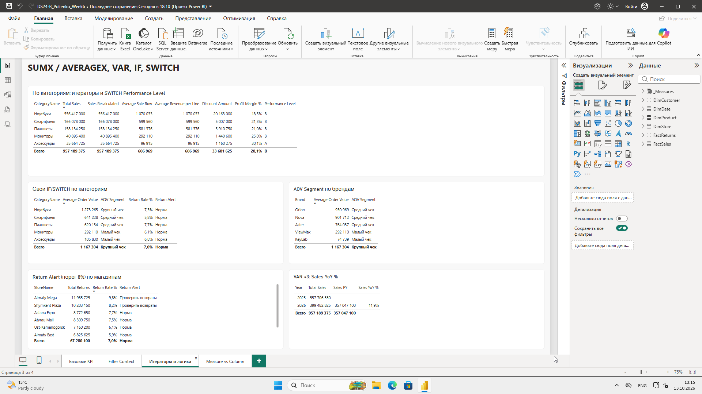
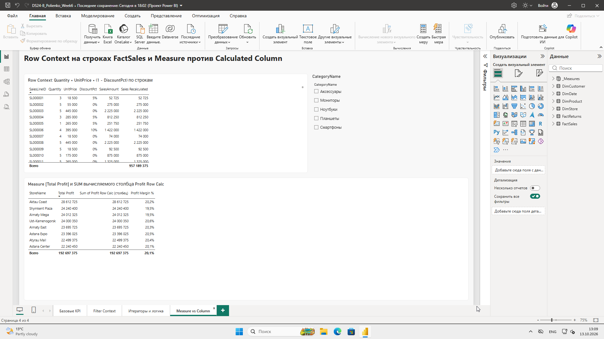
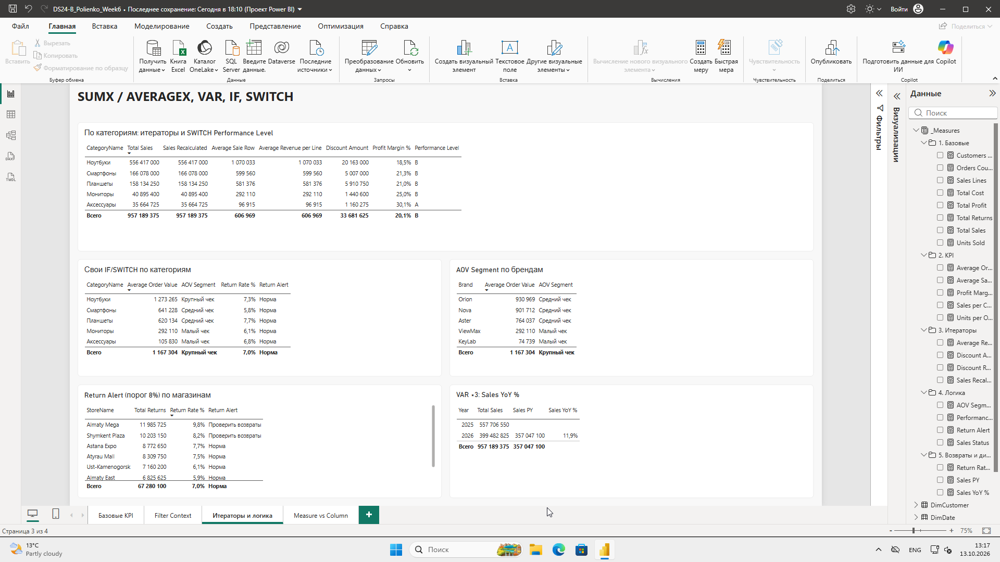
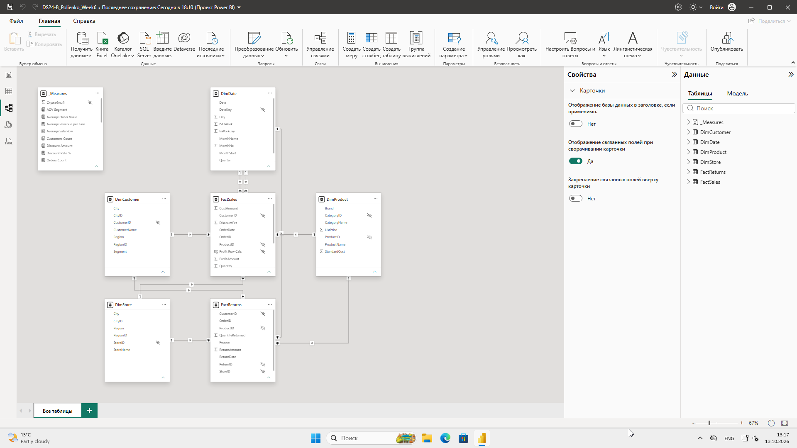

# Практическая работа №6 + СРСП №6. Архитектура DAX: Measures, Calculated Columns, контексты

**Студент:** Полиенко Илья, группа DS 24-Б
**Файл проекта:** `DS24-B_Polienko_Week6.pbix`
**Датасет:** `PowerBI_Week6_DAX_Dataset.xlsx`

## 1. Подготовка модели (задание 1)

Загружены FactSales (1577 строк), FactReturns (210), DimProduct (12), DimCustomer (100), DimStore (8) и DimDate (608). Связи:

| Связь | Тип | Состояние |
|---|---|---|
| DimProduct / DimCustomer / DimStore → FactSales | 1:*, Single | активны |
| DimProduct / DimCustomer / DimStore → FactReturns | 1:*, Single | активны |
| DimDate[Date] → FactSales[OrderDate] | 1:*, Single | **активна** |
| DimDate[Date] → FactSales[ShipDate] | 1:*, Single | неактивна |
| DimDate[Date] → FactReturns[ReturnDate] | 1:*, Single | активна |

**Grain FactSales:** одна строка — одна товарная позиция заказа. Строк 1577, заказов 820.

**Почему связи и grain проверяются до DAX.** Мера считается в Filter Context, а этот контекст приходит к факту через связи. Если связь неверна (*:* или неактивна) или grain не понят, формула может быть синтаксически правильной, но давать неверное число. Например, COUNTROWS вместо числа заказов.

## 2. Таблица _Measures и базовые меры (задания 2–7)

Таблица `_Measures` создана через «Ввести данные» с одним служебным столбцом «Служебный», который скрыт. Все меры лежат в ней и разложены по папкам (displayFolder).

**Зачем меры отдельно от факта.**
- Меры не принадлежат строкам таблицы, их удобно искать в одном месте.
- Если факт заменят или переименуют, меры не потеряются.
- Пользователь видит понятное разделение: данные отдельно, показатели отдельно.

| Папка | Мера | Формула | Значение (вся модель) |
|---|---|---|---|
| 1. Базовые | Total Sales | `SUM(FactSales[SalesAmount])` | 957 189 375 |
| | Total Profit | `SUM(FactSales[ProfitAmount])` | 192 697 375 |
| | Total Cost | `SUM(FactSales[CostAmount])` | 764 492 000 |
| | Units Sold | `SUM(FactSales[Quantity])` | 4 654 |
| | Orders Count | `DISTINCTCOUNT(FactSales[OrderID])` | 820 |
| | Sales Lines | `COUNTROWS(FactSales)` | 1 577 |
| | Customers Count | `DISTINCTCOUNT(FactSales[CustomerID])` | 100 |
| | Total Returns | `SUM(FactReturns[ReturnAmount])` | 67 280 100 |
| 2. KPI | Average Sale Row | `AVERAGE(FactSales[SalesAmount])` | 606 969 |
| | Average Order Value | `DIVIDE([Total Sales], [Orders Count], 0)` | 1 167 304 |
| | Profit Margin % | VAR/RETURN, см. ниже | 20,1 % |
| | Sales per Customer | `DIVIDE([Total Sales], [Customers Count], 0)` | 9 571 894 |
| | Units per Order | `DIVIDE([Units Sold], [Orders Count], 0)` | 5,68 |
| 3. Итераторы | Sales Recalculated | `SUMX(FactSales, Qty × Price × (1 − Disc))` | 957 189 375 |
| | Average Revenue per Line | `AVERAGEX(FactSales, …)` | 606 969 |
| | Discount Amount | `SUMX(FactSales, Qty × Price × Disc)` | 33 681 625 |
| | Discount Rate % | `DIVIDE([Discount Amount], [Total Sales] + [Discount Amount], 0)` | 3,4 % |
| 4. Логика | Sales Status | IF, порог 10 000 000 | — |
| | Performance Level | SWITCH(TRUE()), A/B/C/D | — |
| | Return Alert | IF, порог 8 % | — |
| | AOV Segment | SWITCH(TRUE()), 3 уровня чека | — |
| 5. Возвраты и динамика | Return Rate % | `DIVIDE([Total Returns], [Total Sales], 0)` | 7,0 % |
| | Sales PY | `CALCULATE([Total Sales], SAMEPERIODLASTYEAR(DimDate[Date]))` | — |
| | Sales YoY % | VAR ×3, см. ниже | 2026: +11,9 % |

Форматы:
- денежные меры — `#,0`;
- проценты — `0.0%`;
- Units Sold и количества — целое число.

**Задание 5. DISTINCTCOUNT против COUNTROWS.** Orders Count = 820, а Sales Lines = 1577. Одна строка FactSales — это позиция заказа, а не заказ. В заказе в среднем 1,9 позиции, поэтому строк почти вдвое больше. Число заказов — это количество уникальных OrderID.

**Задание 6. Average Sale Row против Average Order Value.**
- Средняя строка — 606 969 ₸: это средняя сумма одной позиции.
- Средний чек — 1 167 304 ₸: это выручка, делённая на число заказов.

Метрики разные, потому что чек складывается из нескольких позиций. По магазинам: в Aktau Coast средняя строка 629 885, а чек 1 265 395; в Almaty East — 573 967 и 1 068 947 (скриншот 01). Средняя строка отвечает на вопрос «сколько стоит типичная покупка товара», средний чек — «сколько клиент оставляет за визит».

**Задание 7. Profit Margin % в матрице категория × регион магазина.** Значение пересчитывается в каждой ячейке. Аксессуары дают самую высокую маржу (≈30 %), ноутбуки — самую низкую (≈18,5 %), и регионы отличаются слабо.

## 3. Filter Context (задания 8–9, 23)

Мера `[Total Sales]` одна и та же, меняется только набор фильтров (скриншоты 02–07):

| № | Активные фильтры | Total Sales | Orders Count | Profit Margin % |
|---|---|---|---|---|
| 02 | нет | 957 млн | 820 | 20,1 % |
| 03 | Year = 2025 | 558 млн | 495 | 20,1 % |
| 04 | Year = 2026 | 399 млн | 325 | 20,2 % |
| 05 | Brand = Nova | 324 млн | 359 | 20,1 % |
| 06 | Segment = Corporate | 205 млн | 181 | 20,1 % |
| 07 | Segment = Corporate **и** Year = 2026 | 83 млн | 66 | 19,9 % |

**Кто создаёт Filter Context:**
- срезы Year, Brand, Segment;
- строки и столбцы таблицы и матрицы (CategoryName; Region × Segment);
- выделение на других визуалах (cross-filter);
- фильтры уровня визуала, страницы и отчёта.

Формула меры не меняется. Меняется подмножество строк FactSales, по которому выполняется SUM.

**Как связь участвует в контексте.**
- Срез Brand фильтрует DimProduct, фильтр идёт по связи DimProduct[ProductID] 1 → * FactSales[ProductID], и в факте остаются только продажи товаров Nova.
- Срез Segment действует так же через DimCustomer.
- Year — через DimDate по активной связи OrderDate.

Без связи фильтр измерения не достиг бы факта, и мера показывала бы одно и то же число.

## 4. Итераторы и Row Context (задания 10–12, 20, 24)

```
Sales Recalculated =
SUMX(
    FactSales,
    FactSales[Quantity] * FactSales[UnitPrice] * (1 - FactSales[DiscountPct])
)
```

| Мера | Итерируемая таблица | Выражение для строки | Агрегация |
|---|---|---|---|
| Sales Recalculated | FactSales | Quantity × UnitPrice × (1 − DiscountPct) | сумма |
| Average Revenue per Line | FactSales | то же | среднее |
| Discount Amount | FactSales | Quantity × UnitPrice × DiscountPct | сумма |

**Сравнение.**
- Sales Recalculated = Total Sales = 957 189 375 во всех контекстах: по каждой категории, магазину и году (скриншот 08). В источнике SalesAmount уже рассчитан этой же формулой, расхождений нет ни в одной из 1577 строк.
- Average Revenue per Line = Average Sale Row (606 969 в целом; ноутбуки 1 070 033, аксессуары 96 915). Строковое выражение равно SalesAmount, поэтому среднее совпадает.
- Итератор нужен там, где строкового значения нет в таблице. Пример — Discount Amount = 33,7 млн: сумма скидок, которую нельзя получить через SUM одного столбца.

**Задание 12. Row Context вручную** (скриншот 09, первые строки FactSales):

| SalesLineID | Quantity | UnitPrice | DiscountPct | Q × P × (1 − D) | SalesAmount |
|---|---|---|---|---|---|
| SL000001 | 3 | 18 500 | 5 % | 3 × 18 500 × 0,95 = **52 725** | 52 725 ✅ |
| SL000002 | 5 | 55 000 | 0 % | 5 × 55 000 × 1,00 = **275 000** | 275 000 ✅ |
| SL000003 | 5 | 445 000 | 0 % | 5 × 445 000 × 1,00 = **2 225 000** | 2 225 000 ✅ |

**Row Context своими словами.** SUMX проходит по таблице FactSales строка за строкой. На каждом шаге «текущая строка» и есть Row Context. Внутри него обращение `FactSales[Quantity]` возвращает одно значение — количество именно этой строки, а не столбец целиком. Поэтому отдельный фильтр не нужен: выражение вычисляется для каждой строки, а затем SUMX складывает результаты. Внешний Filter Context (срезы, строки визуала) сначала определяет, по каким строкам пойдёт итерация.

## 5. VAR/RETURN, IF, SWITCH (задания 13–15, 21, 27)

**Profit Margin % (финальная версия, VAR с двумя базовыми мерами):**
```
Profit Margin % =
VAR SalesValue = [Total Sales]
VAR ProfitValue = [Total Profit]
RETURN
    DIVIDE(ProfitValue, SalesValue, 0)
```
- `SalesValue` — выручка в текущем контексте;
- `ProfitValue` — прибыль.

Переменные вычисляются один раз, формула читается как текст. Версия без VAR (`DIVIDE([Total Profit], [Total Sales], 0)`) даёт то же значение. По заданию оставлена одна финальная версия, с VAR.

**Sales YoY % (VAR с тремя переменными):**
```
Sales YoY % =
VAR CurrentSales = [Total Sales]
VAR PreviousSales = [Sales PY]
VAR Growth = CurrentSales - PreviousSales
RETURN
    IF(HASONEVALUE(DimDate[Year]) && NOT ISBLANK(PreviousSales), DIVIDE(Growth, PreviousSales))
```
- `CurrentSales` — продажи периода;
- `PreviousSales` — тот же период год назад;
- `Growth` — абсолютный прирост.

Проверка HASONEVALUE нужна, чтобы в итоговой строке без выбранного года не выводился бессмысленный процент. Результат: **2026 к 2025 +11,9 %** (январь–август 2026 — 399,5 млн, январь–август 2025 — 357,0 млн).

**IF:** `Sales Status = IF([Total Sales] >= 10000000, "Высокие продажи", "Обычные продажи")`.
- По магазинам все 8 — «Высокие продажи»: каждый магазин продал 110–142 млн.
- По товарам статус меняется: Keyboard Pro (11,2 млн) ещё «Высокие», Mouse Air (6,4 млн) — «Обычные».

**SWITCH:** `Performance Level` по Profit Margin %, уровни A ≥ 25 %, B ≥ 15 %, C ≥ 5 %, иначе D.

| Категория | Profit Margin % | Level |
|---|---|---|
| Аксессуары | 30,1 % | A |
| Мониторы | 25,0 % | A |
| Смартфоны | 21,3 % | B |
| Планшеты | 21,0 % | B |
| Ноутбуки | 18,5 % | B |

**Свои меры с IF и SWITCH (задание 27):**
- `Return Alert = IF([Return Rate %] > 0.08, "Проверить возвраты", "Норма")`. Порог 8 % взят чуть выше среднего (7,0 %), чтобы подсвечивать только заметно худшие объекты. Срабатывает на Almaty Mega (9,8 %) и Shymkent Plaza (8,2 %), по категориям — нигде: максимум у планшетов, 7,7 %.
- `AOV Segment = SWITCH(TRUE(), [Average Order Value] >= 1000000, "Крупный чек", >= 500000, "Средний чек", "Малый чек")`. Пороги: 1 млн — около среднего чека модели (1,17 млн), 0,5 млн — граница между техникой и аксессуарами.
  - **По категориям:** ноутбуки — крупный чек; смартфоны и планшеты — средний; мониторы и аксессуары — малый.
  - **По брендам:** Orion, Nova, Aster — средний; ViewMax, KeyLab — малый.

## 6. Measure Branching (задания 16, 25)

```
БАЗОВЫЕ (SUM / COUNT по столбцам)          ПРОИЗВОДНЫЕ KPI
──────────────────────────────────         ─────────────────────────────────────────
[Total Sales] ───────┬───────────────────► [Average Order Value] ──► [AOV Segment]
[Orders Count] ──────┤
                     ├───────────────────► [Profit Margin %] ──────► [Performance Level]
[Total Profit] ──────┤
                     ├───────────────────► [Sales per Customer]
[Customers Count] ───┤
                     ├───────────────────► [Sales Status]
                     ├───────────────────► [Return Rate %] ────────► [Return Alert]
[Total Returns] ─────┤
                     ├──► [Sales PY] ────► [Sales YoY %]
                     │
[Units Sold] ────────┴───────────────────► [Units per Order] (+ [Orders Count])
ИТЕРАТОРЫ: [Discount Amount] ──► [Discount Rate %] (+ [Total Sales])
```

- Базовый слой — 8 мер, только в нём есть SUM, DISTINCTCOUNT и COUNTROWS по столбцам.
- Все KPI ссылаются на базовые меры и не дублируют SUM.
- Циклов нет: зависимости идут только слева направо.

Если завтра изменится определение выручки, например начнут вычитать возвраты, достаточно поправить одну меру `[Total Sales]`, и все 10 зависимых KPI пересчитаются сами.

## 7. Measure против Calculated Column и Calculated Table (задания 17–18, 26)

Временный столбец `Profit Row Calc = FactSales[SalesAmount] - FactSales[CostAmount]` создан в FactSales.

| | Calculated Column `Profit Row Calc` | Measure `[Total Profit]` |
|---|---|---|
| Когда вычисляется | При обновлении данных, для каждой строки | В момент запроса визуала, в текущем Filter Context |
| Хранение | Значение каждой из 1577 строк хранится в модели и увеличивает размер | Хранится только формула |
| Контекст | Row Context: видит только свою строку | Filter Context: учитывает срезы и строки визуала |
| Результат | В таблице по магазинам SUM столбца = Total Profit, например Aktau Coast 28 612 725 (скриншот 09) | То же значение |
| Реакция на срез | Сами значения строк не меняются. Меняется только неявная агрегация SUM поверх столбца | Пересчитывается как KPI. Можно сделать долю, маржу, YoY |

Вывод: столбец дублирует ProfitAmount, который уже есть в источнике, и ничего не добавляет. Он скрыт и оставлен только для демонстрации, его можно удалить.

**Почему Total Profit должна быть мерой.** Даже когда ProfitAmount есть в источнике, мера:
- задаёт одно явное определение;
- имеет формат;
- служит базой для Profit Margin %;
- работает в любом контексте;
- не позволяет визуалу неявно выбрать «среднее» или «количество» вместо суммы.

**Calculated Table.** `CorporateCustomers = FILTER(DimCustomer, DimCustomer[Segment] = "Corporate")` даёт 22 строки. Таблица вычисляется при обновлении и хранится в модели как обычная таблица. На срезы она не реагирует: её строки зафиксированы в момент обновления, а мера вычисляется при каждом запросе. Без реальной потребности её создавать не нужно, она дублирует данные DimCustomer. Тот же результат даёт срез Segment = Corporate. В финальную модель таблица не включена.

**Задание 26. Аудит: что можно было ошибочно сделать столбцом**

| Показатель | Ошибка как Calculated Column | Почему Measure лучше |
|---|---|---|
| Profit Margin % | `[ProfitAmount] / [SalesAmount]` по строке, затем SUM или AVERAGE в визуале | Сумма процентов бессмысленна, среднее процентов строк ≠ маржа итога. Мера считает Σprofit / Σsales в любом контексте |
| Average Order Value | столбец «сумма заказа», повторённый в каждой строке заказа | Сумма такого столбца задваивает выручку. Мера Total Sales / DISTINCTCOUNT(OrderID) корректна на любом уровне |
| Sales Status / Performance Level | столбец по строке | Статус должен зависеть от уровня анализа (магазин, категория), а не от одной позиции |
| Discount Amount | столбец Q × P × D | Можно, но он раздувает модель. Итератор SUMX считает то же без хранения |

## 8. Правила хорошей DAX-модели

1. **Один базовый слой.** SUM, COUNT и DISTINCTCOUNT по столбцам пишутся только в базовых мерах, всё остальное ссылается на них (Measure Branching).
2. **Деление только через DIVIDE.** Защищает от деления на ноль и пустых значений.
3. **VAR для повторяющихся и длинных выражений.** Значение вычисляется один раз, а формула читается сверху вниз.
4. **Calculated Column — только для атрибутов, по которым нужно группировать или фильтровать.** Например, «сегмент цены товара». Для любых итогов и KPI — мера.
5. **Меры в _Measures, по папкам, с понятными именами и форматами.** Технические ID скрыты.

## 9. Итоговая аналитическая записка (задание 28, 286 слов)

**Как построить поддерживаемую архитектуру DAX в Power BI.**

Поддерживаемая DAX-модель начинается не с формул, а с модели данных. Нужен понятный grain факта, уникальные ключи измерений и связи 1:* с фильтром от измерения к факту. Только тогда Filter Context — набор фильтров, который срезы, строки визуалов и связи передают в меру, — приходит к таблице фактов предсказуемо.

Главный объект анализа — Measure. Она хранит формулу, а не значения, и вычисляется заново в каждом контексте. Поэтому одна мера [Total Sales] показывает 957 млн на карточке, 558 млн при выборе 2025 года и 83 млн для корпоративных клиентов в 2026 году. Calculated Column, наоборот, вычисляется при обновлении в Row Context, то есть для каждой строки по отдельности, и хранится в модели. Столбец оправдан как атрибут для группировки, но не как KPI: процент или средний чек в виде столбца дают неверные итоги.

Iterator (SUMX, AVERAGEX) соединяет оба мира. Он создаёт Row Context внутри меры, вычисляет выражение для каждой строки и агрегирует результат, не храня промежуточный столбец. Так посчитана сумма скидок, которой нет в источнике.

VAR/RETURN делает формулы читаемыми и быстрыми: переменная вычисляется один раз, а логика читается как последовательность шагов.

Measure Branching организует меры в слои: базовые меры (Total Sales, Total Profit, Orders Count) и производные KPI (Average Order Value, Profit Margin %, Return Rate %), которые ссылаются на базовые. Определение меняется в одном месте, и вся цепочка пересчитывается без правки десятков формул.

Мои правила:
1. Сначала бизнес-вопрос и grain, потом формула.
2. Любой итог — мерой, а не столбцом.
3. Каждый SUM пишется один раз, в базовой мере.
4. Деление — только DIVIDE.
5. Меры хранятся в отдельной таблице и разложены по папкам.

## 10. Выводы

1. Одна формула меры даёт разные результаты в разных Filter Context: 957 → 558 → 399 → 324 → 205 → 83 млн.
2. COUNTROWS(FactSales) = 1577 — это позиции, DISTINCTCOUNT(OrderID) = 820 — это заказы. Выбор функции следует из grain.
3. Средний чек (1,17 млн) почти вдвое выше средней строки (0,61 млн), так как в заказе в среднем 1,9 позиции.
4. SUMX по строковой формуле совпал с SalesAmount: данные внутренне согласованы. Итератор полезен для показателей, которых нет в столбцах (скидки — 33,7 млн).
5. Маржа обратна чеку: дорогие ноутбуки дают низкую маржу (18,5 %, уровень B), дешёвые аксессуары — 30 % (уровень A).
6. Возвраты в целом 7,0 %, но в Almaty Mega они 9,8 % — объект для проверки по мере Return Alert.
7. Продажи 2026 к тому же периоду 2025 выросли на 11,9 %.

## 11. Ответы на вопросы защиты (кратко)

1. **Measure и Calculated Column.** Measure вычисляется по запросу в Filter Context и не хранит значений. Column вычисляется при обновлении по каждой строке (Row Context) и хранится.
2. **Calculated Table** вычисляется при обновлении модели и хранится как таблица, на срезы не реагирует.
3. **Почему Total Sales — мера.** Это итог, который должен пересчитываться в любом контексте.
4. **COUNTROWS ≠ заказы.** Строка — это позиция, а в заказе их несколько.
5. **Grain и DISTINCTCOUNT.** Если сущность (заказ) не совпадает с grain строки, её считают через DISTINCTCOUNT её ключа.
6. **AVERAGE и AOV.** AVERAGE — средняя позиция, AOV — выручка, делённая на число заказов.
7. **Почему DIVIDE.** Безопасно при нуле и BLANK, есть альтернативный результат.
8. **SUMX** проходит по строкам таблицы, вычисляет выражение в каждой и суммирует.
9. **Row Context** — контекст текущей строки при итерации.
10. **Filter Context** — набор фильтров, под которым вычисляется мера.
11. **Кто создаёт Filter Context.** Срезы, строки и столбцы визуалов, перекрёстная фильтрация, фильтры страницы и отчёта, CALCULATE.
12. **Связи и Filter Context.** Связи переносят фильтр с измерения на факт.
13. **SUM и SUMX.** SUM складывает один столбец, SUMX — результат выражения по строкам.
14. **Когда AVERAGEX.** Когда среднее нужно от вычисляемого по строке выражения.
15. **VAR/RETURN** — читаемость, однократное вычисление, удобная отладка.
16. **Почему SWITCH(TRUE()).** Плоский список условий вместо «лесенки» IF.
17. **Measure Branching** — меры, построенные на других мерах.
18. **Почему не повторять SUM.** Дублирование логики: одно изменение нужно вносить во много мест, и легко получить расхождения.
19. **Calculated Columns и размер модели.** Хранится значение каждой строки, особенно тяжело с высокой кардинальностью.
20. **Мера или столбец.** Если результат зависит от выбора пользователя или это итог — мера. Если нужен атрибут строки для группировки или фильтра — столбец.

## Скриншоты

| № | Файл | Что показано |
|---|---|---|
| 01 | 01_Базовые_KPI.png | Карточки, AOV против средней строки, маржа категория × регион, IF |
| 02–07 | 02…07_FilterContext_*.png | Одна мера в 6 контекстах |
| 08 | 08_Итераторы_VAR_IF_SWITCH.png | SUMX, AVERAGEX, SWITCH, свои IF/SWITCH, YoY |
| 09 | 09_RowContext_и_Measure_vs_Column.png | Строки для Row Context, мера против столбца |
| 10 | 10_Measures_папки.png | Таблица _Measures с папками |
| 11 | 11_Модель.png | Модель с _Measures |










